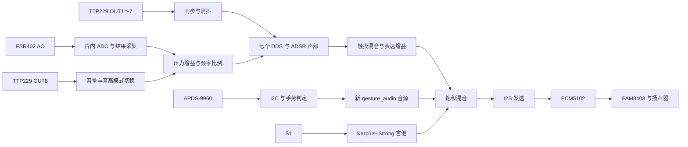

**当前工程代码说明（按 2026-10-12 的源码整理）**

这份说明覆盖 `src` 中的全部 RTL 和约束、`sim` 中的测试、`tools` 中的项目脚本，以及 `debug` 和备份目录的用途。硬件行为按当前 `top.v` 的连接解释；历史演示和旧测试不会被当成当前功能。第三方 Icarus/GTKWave 和 Gowin 生成网表按工具与生成产物说明。

**一、整个工程在做什么**

这是一个在 FPGA 内实时产生声音的系统。TTP229 提供七个触摸音符和一个模式键；FSR402 的电压经过片内 ADC 转成数字，控制触摸音符的音量或音高；APDS-9960 输出手势数据，FPGA 将方向映射成音符；S1 触发一根虚拟吉他弦。数字音频混合后通过 I²S 送到 PCM5102。PAM8403 位于模拟音频链路，没有对应的 FPGA 控制模块。



主工程的逻辑时钟是 `clk=50MHz`。大部分音频寄存器只在 `frame_ce=1` 时更新，因此音频采样率低于逻辑时钟。ADC 硬核另外使用 2.5MHz 用户时钟，并通过采集模块把结果送回 50MHz 逻辑域。

**二、阅读 Verilog 前要认识的写法**

| 写法 | 在本工程中的意义 |
| --- | --- |
| `module ... endmodule` | 一块硬件模块的接口和内部电路 |
| `input/output/inout` | 输入、输出、双向引脚；I²C SDA 是双向线 |
| `wire` | 模块之间或组合逻辑之间的连线 |
| `reg` | 可以在过程块中赋值的变量；时钟过程中的持久状态一般合成为寄存器，组合过程里的 `reg` 不一定是寄存器 |
| `always @(posedge clk)` | 在时钟上升沿更新状态 |
| `always @*` | 输入变化后重新计算组合逻辑 |
| `<=` | 非阻塞赋值；本次时钟边沿读取旧值，边沿后统一更新，所以多个流水级不会瞬间穿透 |
| `assign` | 持续驱动一条组合连线 |
| `parameter` | 编译时配置，不是运行时按键变量 |
| `localparam` | 模块内部的编译时常量，例如状态编号和除数 |
| `.port(signal)` | 将子模块端口连接到父模块信号；左边是子模块名字，右边是连接内容 |
| `.key_s1(1'b0)` | 该子模块的输入固定为 0，不连接板载 S1 |
| `.raw_u()` | 显式声明该输出目前不使用 |
| `signed [15:0]` | 16 位有符号数，范围 -32768～32767；PCM 正、负半波都需要它 |
| `{...}` | 位拼接；如把四个 32 位音高合成一条 128 位总线 |
| `bus[i*32 +: 32]` | 从第 `i*32` 位开始取 32 位；最低段通常对应第 0 个声部 |
| `>>>` | 有符号操作数的算术右移，用于保留负数符号的缩放 |
| `generate for/if` | 编译时展开硬件；例如生成七套独立声部，不是运行时轮流计算七个键 |
| `task/function` | 复用逻辑描述；RTL 中的任务和函数仍要满足可综合条件，仿真任务则可以包含等待和延时 |
| `` `timescale 1ns/1ps `` | 仿真时间单位与精度；板载频率由实际 `clk` 和约束决定 |
| `syn_preserve` | 请求综合工具保留特定寄存器，例如同步器和音源流水级 |

`resetn`、`rst_n` 都表示低有效复位。`sample_ce`、`frame_ce` 是“这一个逻辑时钟周期允许更新一次音频采样”的使能信号，不是独立音频时钟。

**三、top.v：整个系统的接线和配置入口**

[打开 top.v](D:/GOWIN/pcm5102_pam8403/src/top.v)。它主要连接各模块，具体算法放在子模块中。

1. `power_count` 初始化为 0，累加到 63 后保持不变。`resetn=&power_count` 在六位全为 1 时释放复位，等待约 1.26µs。传感器的长启动等待由各自模块完成。
2. `u_clk_div` 产生 BCK、LRCK、位序号和帧使能。触摸、吉他、手势和混音器共享同一音频帧基准。
3. 两个 `ttp229_gpio_input` 分别处理 OUT1～7 与 OUT8。前者使用 2ms 消抖，后者使用 20ms，互相不用的输入按空闲电平屏蔽。
4. `touch_keys={mode_keys[7],note_keys[6:0]}` 合并按键结果。`touch_note_gates={1'b0,touch_keys[6:0]}` 让第八个声部门控始终为 0。
5. `u_fsr_mode` 从 OUT8 产生音量/音高模式。`u_fsr_adc` 提供压力数字码。
6. 两个 `fsr_dynamics` 分别算音量增益和音高比例。只启用当前模式对应的一项，另一项平滑返回满比例。
7. `u_fsr_pitch_scaler` 将七个基础音高乘以同一个压力比例，再送入触摸声部。
8. `touch_voices[0]` 创建 4 个声部，`touch_voices[1]` 创建 3 个声部，对应 C4～B4 七个音符。
9. `pressure_enabled` 分支先混合两组触摸音频，再乘 `fsr_gain`；`FSR_ENABLE=0` 时走旁路。这个参数只旁路表达，ADC 实例和模拟引脚配置仍保留。
10. `u_gesture` 使用新的 `gesture_top`，内部调用新的 `gesture_audio`。其 `key_s1` 固定为 0，因此主工程手势组保持 C4～F4；板载 S1 连接吉他，S2 连接手势音色和颤音控制。
11. `u_string` 产生吉他 PCM，再按 `VOLUME_SHIFT` 右移缩放。
12. `u_output_mix` 相加吉他、触摸和手势样本，`u_i2s_tx` 发送最终 PCM。默认压力分支下 `touch_mix1=0`，它是为了兼容旁路分支而保留的混音输入。

| top 参数 | 当前默认值 | 实际作用 |
| --- | --- | --- |
| `VOLUME_SHIFT` | 4 | 主音源基础幅度约除以 16，给多声部相加保留余量 |
| `STRING_LENGTH` | 110 | 吉他延迟线长度，决定主要音高 |
| `KEY_DEBOUNCE_CYCLES` | 250000 | 吉他 S1 的稳定确认，约 5ms |
| `TOUCH_STARTUP_US` | 600000 | 触摸输入约 600ms 后才开始确认按键 |
| `TOUCH_DEBOUNCE_MS` | 2 | 七个音符键消抖 |
| `TOUCH_MODE_DEBOUNCE_MS` | 20 | 模式键消抖 |
| `TOUCH_ACTIVE_LOW` | 0 | 当前 OUT 引脚按高有效解释 |
| `ADSR_ATTACK_SAMPLES` | 98 | 触摸起音约 2ms |
| `ADSR_DECAY_SAMPLES` | 3906 | 衰减阶段约 80ms |
| `ADSR_SUSTAIN_LEVEL` | 39321 | 持续幅度约 60% |
| `TOUCH_ADSR_RELEASE_SAMPLES` | 488 | 触摸松开尾音约 10ms |
| `ADSR_RELEASE_SAMPLES` | 4883 | 目前保留在顶层，但当前触摸实例使用上面单独的释放参数 |
| `FSR_SAMPLE_HZ` | 1000 | ADC 转换请求频率 |
| `FSR_ADC_INVERT` | 0 | 当前数字码随输入电压增加，不做反向 |
| `FSR_GAIN_REVERSE` | 1 | 重压时音量降低 |
| `FSR_ADC_ZERO/FULL` | 32 / 600 | 相对压力映射的下、上阈值，不是牛顿或公斤 |
| `FSR_MIN_GAIN` | 16384 | 重压端音量增益约 25% |
| `FSR_SLEW_STEP` | 64 | 每帧最多改变 64 个增益码 |
| `FSR_PITCH_MIN_RATIO` | 32768 | 最低频率比例约 0.5，即低一个八度 |
| `FSR_PITCH_SLEW_STEP` | 64 | 音高比例每帧的最大变化量 |

基础增益、ADSR 包络和压力增益会相乘。`VOLUME_SHIFT=4` 并不意味着最终声音恒定为满幅的 1/16；衰减到持续阶段或施压后还会进一步降低。

**四、clk_div.v 和 i2s_tx.v：如何把样本送出 FPGA**

[clk_div.v](D:/GOWIN/pcm5102_pam8403/src/clk_div.v) 使用四位计数器。计数到 7 时拉高 BCK，到 15 时拉低，周期为 16 个 50MHz 时钟：

```text
BCK = 50,000,000 / 16 = 3,125,000 Hz
一个立体声帧 = 64 个 BCK
Fs = 3,125,000 / 64 = 48,828.125 Hz
每帧时间 = 20.48µs
```

`bit_index` 从 0～63 循环；其高位控制左右声道。`frame_ce` 在帧起始的 BCK 下降沿对应的逻辑周期出现。RTL 使用 `posedge clk`，只根据使能决定是否更新，BCK/LRCK 是对外输出。

[i2s_tx.v](D:/GOWIN/pcm5102_pam8403/src/i2s_tx.v) 每个声道占 32 位：第 0 位是 I²S 的一位延迟，第 1～16 位按最高位优先发送 16 位 PCM，第 17～31 位发 0。左声道开始时锁存一次样本，右声道发送同一个 `frame_sample`，所以当前输出是左右声道相同的双单声道。静音时仍发送完整时钟和零数据。

`frame_sample` 负责一帧内左右一致，`shift_word` 负责逐位输出，`din` 只在 BCK 下降沿对应的时钟使能上变化。混音和发送器同一边沿读取旧值，形成正常的流水延迟。

**五、ttp229_gpio_input.v：触摸输入怎样变成稳定按键**

[ttp229_gpio_input.v](D:/GOWIN/pcm5102_pam8403/src/ttp229_gpio_input.v) 读取八根并行 OUT 引脚，不进行 SDO 串行扫描。`meta`、`sync` 是两级同步器，先把外部异步输入送入逻辑时钟域。`ACTIVE_LOW` 决定是否取反。

`startup_count` 在启动阶段计数；完成后 `ready=1`。此后 `tick_count` 每 1ms 产生一次检查机会。每个键有独立的 `counts[k]`：如果采样电平和稳定电平相同则清零，否则持续计数，达到确认次数才改变 `keys_stable[k]`。按下和松开都执行确认，多个键互不占用计数器。`keys_raw` 是同步后的即时电平，`keys_stable` 是消抖后的电平。

主 top 的 `touch_scl=1` 给 TTP229 固定串行时钟空闲电平，它与手势 I²C 的 `scl` 是两根不同信号。

**六、压力通路的四个文件**

[gowin_fsr_adc.v](D:/GOWIN/pcm5102_pam8403/src/gowin_fsr_adc.v) 包含两个模块。

`gowin_fsr_adc` 每 10 个主时钟翻转一次 `adc_clk`，产生 2.5MHz；实例化器件内置 `ADC` 原语，配置为外部电压输入。模拟 PAD 由 CST 的 `USE_ADC_SRC bus0 IOT56` 选择，所以 top 没有普通的数字 `fsr_ao` 输入端口。

同文件的 `fsr_adc_capture` 管理跨时钟采样握手：每隔一段时间发请求，请求保持 64 个主时钟，先等待同步后的 ready 变低，再等待 ready 变高，避免把上一笔完成状态当成新结果。完成时锁存 `raw_value` 并产生一个周期的 `sample_valid`。默认超时为 100000 个主时钟，即约 2ms；超时时保留上次读数并允许以后重试。数字转换使用 `raw_value[10:1]`，达到 2046 时饱和为 1023。数字饱和仅处理数值，模拟电压范围要由实际接线保证。

[fsr_dynamics.v](D:/GOWIN/pcm5102_pam8403/src/fsr_dynamics.v) 把 10 位 ADC 码映射到 16 位比例。先根据 `ADC_INVERT` 决定方向，再用 ZERO/FULL 限定范围。中间段采用固定倒数乘法与右移，避免运行时长除法。`valid1/valid2` 与数据流水级对齐。

`target_gain` 是立即计算的目标；`gain` 每个音频帧向目标最多移动 `SLEW_STEP`。这样的变化较平滑。`expression_enable=0` 时，输出比例平滑回到 `65535`。顶层用同一个模块两次，第二次的“gain”实际表示音高比例，不是声音幅度。

[fsr_mode_select.v](D:/GOWIN/pcm5102_pam8403/src/fsr_mode_select.v) 用 `key8_armed` 防止长按重复切换：稳定松开后重新允许下一次按下；按下后翻转 `pitch_mode` 并解除允许。启动时一直按住 K8 不会直接切换，必须先释放。

[fsr_pitch_scaler.v](D:/GOWIN/pcm5102_pam8403/src/fsr_pitch_scaler.v) 对七个音符并行计算：

```text
new_phase_inc ≈ base_phase_inc × pitch_ratio / 65536
```

比例为 `65535` 时直接使用基础步进，避免本该恢复原音高时仍有小误差。乘法和输出寄存器分成两个逻辑时钟流水级；只改变步进，不重置 DDS 相位。第八个打包位置输出 0。

压力模式对应的最终行为是：音量模式保留原音高，压力改变增益；音高模式增益返回接近 1，压力改变七个音符共同的频率比例。压力自身不触发音符。

**七、触摸音源：poly_synth、synth_voice、dds_voice、sine_rom、adsr_env、envelope_gain**

[poly_synth.v](D:/GOWIN/pcm5102_pam8403/src/poly_synth.v) 是一组独立声部和一个混音器。输入的 `gates` 控制各声部是否按住，`phase_increments` 的每个 32 位段提供对应音高。`VOICE_COUNT` 决定实际生成的声部数量，不生成的输出段明确接 0。当前 top 按 4+3 配置。

[synth_voice.v](D:/GOWIN/pcm5102_pam8403/src/synth_voice.v) 将振荡器、包络和乘法器连起来：`dds_voice` 产生波形，`adsr_env` 产生音量轮廓，`envelope_gain` 相乘。它没有用门控直接截断输出，因为松开键后还要保留 RELEASE 尾音。

[dds_voice.v](D:/GOWIN/pcm5102_pam8403/src/dds_voice.v) 保存 32 位 `phase`，每帧做 `phase += phase_inc`。最高 10 位作为正弦表地址。整数溢出自然实现相位回绕。对应频率为：

```text
frequency = phase_inc × Fs / 4294967296
```

增大步进，波形周期变短，音高变高。即使声部静音，DDS 相位仍继续运行；改变压力比例不会把相位清零。

[sine_rom.v](D:/GOWIN/pcm5102_pam8403/src/sine_rom.v) 是有效 1024 点的 16 位数学正弦表。它只列出四分之一周期的 257 个常数，使用镜像和符号重建四个象限。长 `case` 是不同地址的幅度常数，不是一段音乐录音。

[adsr_env.v](D:/GOWIN/pcm5102_pam8403/src/adsr_env.v) 有 IDLE、ATTACK、DECAY、SUSTAIN、RELEASE 五个状态。按下进入渐强；到满比例后衰减到持续比例；按住保持；松开渐弱到零。中途松开或重按从当前增益继续，避免突变。

每个线性阶段开始时，模块用 16 个逻辑时钟执行一次短除法，得到整数步长和余数。每帧加减基本步长，并累计余数决定何时多走一格，因此能在指定采样数上准确到达阶段终点。`active` 表示状态不是 IDLE，而不是当前输入键是否为 1。

[envelope_gain.v](D:/GOWIN/pcm5102_pam8403/src/envelope_gain.v) 使用正的 Q0.16 增益。先把 unsigned 的 `gain` 前面补 0，再作为 signed 参与乘法，防止把大于 32767 的正增益误解为负数。计算近似为：

```text
sample_out = sample_in × gain / 65536 / (2^VOLUME_SHIFT)
```

乘积在帧边沿寄存，带来一帧流水延迟。该文件既给每个声部做 ADSR 缩放，也给整个触摸混音做压力缩放。

**八、新手势通路的六个音频/控制文件与 I²C 驱动**

[gesture_top.v](D:/GOWIN/pcm5102_pam8403/src/gesture_top.v) 是新的子系统入口。它实例化 `u_i2c`、`u_ctrl`、`u_audio`，接收父 top 的 resetn 和 frame_ce，输出手势 PCM 和事件信息。本次版本按要求仅接手势识别与发声，原来的 OLED/串口完整文件在备份目录中。

[i2c_master.v](D:/GOWIN/pcm5102_pam8403/src/i2c_master.v) 把寄存器读写命令转换为 SDA/SCL 时序。`cmd_start` 发起事务，`cmd_addr/reg/rw/wdata/rdlen` 给出设备、寄存器、方向和数据，`busy` 表示进行中，`done` 表示完成，`nack` 表示没有应答，每收到一个字节会给出 `rdata/rvalid`。

默认将一个 100kHz SCL 周期分成四段，每段 125 个 50MHz 时钟。状态机完成 START、逐字节发送、ACK、重复 START、逐字节接收、主机 ACK/NACK 和 STOP。读取先写寄存器地址，再重复起始发送读地址。最后一个读字节后发送 NACK。

SDA/SCL 的输出只能是 0 或 Z：拉低是主动驱动，Z 是释放总线，由上拉形成高电平。该实现按自己的分段计数推进，没有根据实际 SCL 电平等待从机时钟拉伸。调用方要在事务中保持命令字段稳定，当前 APDS 控制器遵循这一用法。

[apds9960_ctrl.v](D:/GOWIN/pcm5102_pam8403/src/apds9960_ctrl.v) 负责“哪些寄存器要访问、数据代表什么”，I²C 驱动负责“怎样把这些访问送到线上”。可按如下流程读它：

```text
等待约100ms → 读取ID → 写13步配置 → 回读ENABLE/GCONF2/GPULSE
→ init_done → 周期读取状态/接近值/FIFO级数
→ 读取FIFO中U,D,L,R四通道 → 更新手势追踪
→ 满足离开条件 → 计算起终方向 → 上报事件 → 继续轮询
```

代码使用 7 位地址 `7'h39`；设备 ID 接受 AB、9C、A8、9E。FIFO 级数只接受不超过 32；每组四个字节依次为上、下、左、右。`acc_*` 求和，`raw_*` 给出批次均值，均值用重复减法求出，避免长组合除法。

初始 32 次完整轮询估计环境背景，之后在没有手势时慢速更新背景。判定手是否存在时比较四路总强度减去总背景后的余量；开始和继续追踪使用不同阈值，亮环境下还增加按背景比例计算的噪声余量。

追踪保存第一组和最后一组可靠样本。饱和样本可以证明手仍在，但不能用作方向端点。方向比较基于 `(U-D)/(U+D)` 和 `(L-R)/(L+R)` 的前后变化，通过交叉乘法避免直接除法；要求至少四个可靠样本和足够的比例变化，再在垂直与水平运动中选择较强方向。

连续三个安静轮询并且自最后有效信号经过约 15ms，才认为手势结束。空 FIFO 本身不足以结束手势，因为可能刚好在两次光学采样之间。

`gesture_valid` 既可能表示有信号的原始批次，也可能表示最终方向上报；`dir_evaluated=1` 才说明已经进行方向判定。无效方向仍可能上报，所以音源还会检查方向组合是否对应一个音符。`dbg_error` 等输出保存 NACK、ID、配置回读、FIFO 溢出、长度不符等诊断信息，当前顶层显式不使用这些端口。

[gesture_audio.v](D:/GOWIN/pcm5102_pam8403/src/gesture_audio.v) 有两种连接方式。独立模式内部产生 I²S 时钟和 DIN；主 top 使用 `SHARED_AUDIO_CLOCK=1`，使用传入的 `shared_frame_ce`，只输出 `audio_sample`，所有真实 I²S 引脚由父 top 驱动。

有效音符条件是 `sensor_ready && gesture_valid && dir_evaluated && event_inc!=0`。新事件在任意主时钟都能锁存，不能要求它恰好撞到音频帧。`note_inc` 锁存该音符的基础步进，`note_timbre` 锁存音色，`remaining` 按帧倒计时；后来的新事件取代前一个并重启时长。

| 起点→终点 | 主工程音符 | 子模块支持的另一组音符 |
| --- | --- | --- |
| 上→下 | C4 | G4 |
| 左→右 | D4 | A4 |
| 下→上 | E4 | B4 |
| 右→左 | F4 | C5 |

子模块的 S1 能在这两组之间选择，但主 top 传入 0，板载 S1 只给吉他，所以当前主工程不会按 S1 切换手势组。模块注释中“八音符”的含义是两组总共八种映射，并非当前 top 同时开放八种手势音符。

S2 的按下和松开先稳定确认约 20ms。短按释放时音色按正弦→钢琴→长笛→尤克里里→鼓轮换；稳定按住后约 0.8s 切换颤音，长按释放不会再算一次短按。切换音色只影响下一次手势，已发音音符保留自己的 `note_timbre`。

不同音色的计时长度默认约为正弦 0.3s、钢琴 1.2s、长笛 0.5s、尤克里里 0.7s、鼓 0.4s。额外的 `gain` 在 0～256 之间每帧加减 1，使起音和收尾约 5.24ms，不突然截断波形。`sine_frame`、`voice_frame` 和对应增益寄存器对齐各音色的流水延迟。

[gesture_nco_sine.v](D:/GOWIN/pcm5102_pam8403/src/gesture_nco_sine.v) 接收可变 `phase_inc`，产生有效 256 点的正弦。与触摸 1024 点表不同，它用相位最高八位寻址。`sine_q` 在 50MHz 时钟下寄存查表结果，将查表与后续音色乘法拆开；相位只在音频帧变化，查表结果在下个音频采样前已经稳定。

[gesture_piano_voice.v](D:/GOWIN/pcm5102_pam8403/src/gesture_piano_voice.v) 生成 2、3、4 倍频泛音，用约 0.75 的基音、0.125 的二次泛音和各 0.0625 的三/四次泛音合成钢琴近似音色。`body_env` 慢衰减，`bright_env` 快衰减，所以起音较亮、后来变柔和。`partial2/3/4` 也共享给其他音色。

[extra_voices.v](D:/GOWIN/pcm5102_pam8403/src/extra_voices.v) 一次生成三种候选音色，再由上层选择。长笛混合基音、泛音与高通后的伪随机气息噪声，并逐渐增加气息包络。尤克里里将低频主体与高频泛音分别衰减，高频消失更快。鼓混合带快速下滑音高的振荡器和短噪声冲击。它们都是逻辑生成的近似音色，不是采样录音。

[vibrato.v](D:/GOWIN/pcm5102_pam8403/src/vibrato.v) 用约 6Hz 的低频正弦给频率步进增加正负偏移，最大深度约 ±1/64。`depth` 用 256 帧缓慢开关效果。两个乘法之间加寄存器分开长路径；若新音符刚到导致乘积还属于上一个音高，就先使用新的原始步进，避免套用旧音符偏移。

**九、geita.v：S1 为什么像拨一根弦**

[geita.v](D:/GOWIN/pcm5102_pam8403/src/geita.v) 实现 Karplus–Strong。S1 经两级同步和 5ms 稳定确认后置 `pending`；下个音频帧开始填入一段 ±16384 的伪随机噪声，长度由 STRING_LENGTH 决定。这相当于拨弦的初始激励。

填充完成后，循环读取延迟线里的数值，与前一个值求平均，减去少量损耗，写回原位置。高频内容和能量逐渐衰减，形成有周期的弦音。读取与回写分两个逻辑周期，有利于推断同步 RAM；没有按音频帧顺序同时扫描全条延迟线。

平均采用有符号除以 2，负数向零截断；损耗按绝对值计算并向上取整，减少衰减末期残留的直流极限循环。`pointer` 走到末尾回到 0，`fill_remaining` 表示还需填多少个初始噪声样本。释放 S1 不直接静音，声音自然衰减；再次按下则重新填充。

频率大约为 `Fs/(STRING_LENGTH+0.5)`，默认 110 点约 441.9Hz。这个模块只模拟一根弦，不包含完整吉他的和弦、指法和琴体声学。

**十、audio_mixer.v：多种音源怎样相加**

[audio_mixer.v](D:/GOWIN/pcm5102_pam8403/src/audio_mixer.v) 把四个 16 位 signed 输入先符号扩展到 24 位，再分两组相加，最后可按 MIX_SHIFT 缩放。它不会按当前按键数量平均，因此增加一个音符不会自动压低其他已按音符。

超过 32767 时输出 32767，低于 -32768 时输出 -32768，同时 `clipped=1`。这样限制溢出，不让大的正数绕回负数。顶层、声部组和触摸表达前的组合都复用了这个文件。

**十一、src 中保留的旧版、备用模块和 IP 模板**

文件在项目列表中启用，并不等于最终电路中一定存在。必须从 `top` 实例树可达且输出有作用，综合才会保留它。

| 文件 | 代码作用 | 当前主工程状态 |
| --- | --- | --- |
| [gesture_voice.v](D:/GOWIN/pcm5102_pam8403/src/gesture_voice.v) | 上一个共享 PCM 手势音源实现 | 工程 enable=0，已由新 gesture_audio 替换 |
| [nco_sine.v](D:/GOWIN/pcm5102_pam8403/src/nco_sine.v) | 固定 INC 的 256 点正弦音源 | 不在主 top 通路，单元测试和旧调试工程使用 |
| [piano_voice.v](D:/GOWIN/pcm5102_pam8403/src/piano_voice.v) | 原钢琴近似模块，依赖动态振荡器接口 | 主通路使用 gesture_piano_voice；它的旧 nco 接口与当前固定步进 nco_sine 不一致，不能直接替代新模块 |
| [button_filter.v](D:/GOWIN/pcm5102_pam8403/src/button_filter.v) | 两级同步、稳定确认、每次按下一个 pressed 脉冲 | 备用通用按键模块；当前吉他和手势各有自己的按键处理 |
| [volume_key.v](D:/GOWIN/pcm5102_pam8403/src/volume_key.v) | 按住 S1 时放行缩小后的正弦，松开立即归零 | 早期按键发声和 GAO 调试使用 |
| [pitch_control.v](D:/GOWIN/pcm5102_pam8403/src/pitch_control.v) | 事件轮换 A4、C5、E5、A5 步进 | 早期音高演示，当前未连接 |
| [poly_demo_control.v](D:/GOWIN/pcm5102_pam8403/src/poly_demo_control.v) | 四种多声部试听场景，控制某一声部的释放/变调 | 早期演示，当前未连接 |
| [twinkle_sequencer.v](D:/GOWIN/pcm5102_pam8403/src/twinkle_sequencer.v) | 42 个小星星旋律事件及三声部伴奏；INTRO/NOTE/GAP/TAIL/IDLE 状态控制时间 | 歌曲演示保留，当前 top 不自动播放歌曲 |
| [gowin_clkdiv.v](D:/GOWIN/pcm5102_pam8403/src/gowin_clkdiv/gowin_clkdiv.v) | 包装 Gowin CLKDIV 原语，DIV_MODE=2 | 当前 top 使用自行计数的 clk_div，不调用这个 IP |
| [gowin_dce.v](D:/GOWIN/pcm5102_pam8403/src/gowin_dce/gowin_dce.v) | 包装 Gowin DCE 时钟使能原语 | 当前不在主工程启用文件中，也未实例化 |
| [gowin_clkdiv_tmp.v](D:/GOWIN/pcm5102_pam8403/src/gowin_clkdiv/gowin_clkdiv_tmp.v) | 告诉使用者如何实例化 Gowin_CLKDIV | 代码片段模板，不是单独的完整设计模块 |
| [gowin_dce_tmp.v](D:/GOWIN/pcm5102_pam8403/src/gowin_dce/gowin_dce_tmp.v) | 告诉使用者如何实例化 Gowin_DCE | 同上 |

小星星模块以音频帧计时，旋律声部与和弦声部输出一条打包总线；某些旋律音符占两个节拍。当前 S1 的实际功能由 geita 决定，不由这些保留演示模块决定。

**十二、工程配置和约束**

[PCM5102_PAM8403.gprj](D:/GOWIN/pcm5102_pam8403/PCM5102_PAM8403.gprj) 选择 GW5A-25A 器件，列出 Verilog、CST、SDC 文件及 enable 标记。它不是音频算法。`.gprj.user` 保存 IDE 的流程和界面状态，不是另一个功能顶层。

[PCM5102_PAM8403.cst](D:/GOWIN/pcm5102_pam8403/src/PCM5102_PAM8403.cst) 定义逻辑端口对应的真实封装引脚，以及 3.3V IO 标准、上下拉与输出驱动。当前 clk=E2，S1/S2=H11/H10，BCK/LRCK/DIN=K2/K1/L1，触摸 OUT1～8=K4/L2/J4/G1/G2/L3/L4/J2，touch_scl=F6；手势 SCL/SDA=H4/G4。ADC 模拟引脚由 `USE_ADC_SRC` 选为 J8/K8，不以普通 IO_LOC 表达。

[PCM5102_PAM8403.sdc](D:/GOWIN/pcm5102_pam8403/src/PCM5102_PAM8403.sdc) 告诉布局布线工具主时钟周期是 20ns，并把外部异步按键到第一级同步寄存器的路径排除出普通同步建立时间计算。排除只针对同步入口，内部寄存器之间仍要满足时序。它与 CST 的作用不同：CST 管位置和电气属性，SDC 管时间要求。

`src/PCM5102_PAM8403.rao` 是留存的空 GAO 配置，已不在主工程文件列表中。GAO 是硬件采样调试工具，与产生音频本身不同。

**十三、sim 中每个文件的作用**

仿真文件不会作为当前 FPGA 顶层烧录。`initial` 设定刺激，`always #10` 产生测试时钟，task 中的等待模拟按键和事件，`$fatal` 使错误退出，`$display` 给出结果，`$fopen/$fdisplay` 导出采样数据。

当前 `tools/run_sim.ps1` 默认执行下面六项，表中的“默认”由脚本列表确定，并不意味着其余代码都无用。

| 测试文件 | 检查内容 | 使用位置 |
| --- | --- | --- |
| `tb_karplus.v` | 噪声激励、40000 个独立整数递推参考样本、自然尾音和重触发 | 默认；吉他算法 |
| `tb_guitar_top.v` | 真正 top 的吉他 PCM、BCK/LRCK 时间、I²S 填充、双声道一致 | 默认；+long_wave 可延长导出 |
| `tb_audio_units.v` | 256 点旧正弦、相位回绕、同步按键、signed 缩放、发送器边界刺激 | 默认；基础单元 |
| `tb_gesture_nco_pipeline.v` | 新寄存查表与原组合查表在音频使能上的 1024 个样本一致 | 默认；流水修改等价性 |
| `tb_gesture_audio.v` | 新手势音源的两组八音符、无效事件过滤、保持音高、音色/颤音、最终静音 | 默认；新模块 |
| `tb_top_sensors.v` | 七键独立控制、短脉冲过滤、ADC 音量、K8 切换、手势混音、无削波、外部 I²S | 默认；主工程联合测试 |
| `tb_adsr_env.v` | 精确线性包络、中途释放、重触发、分段除法、极端参数、复位 | 可单独选；包络单元 |
| `tb_audio_mixer.v` | 4 路求和、正负饱和、抵消、缩放、随机向量、使能和复位 | 可单独选；混音单元 |
| `tb_button_filter.v` | 按下/松开消抖、短脉冲、一次长按只产生一次事件 | 可单独选；备用按键单元 |
| `tb_dds_voice.v` | 1024 点正弦 DDS 与数学参考、频率步进/相位行为 | 可单独选；触摸振荡器 |
| `tb_envelope_gain.v` | signed PCM 与 unsigned 增益相乘、缩放、流水和零增益 | 可单独选；乘法增益 |
| `tb_fsr_adc_capture.v` | ready 同步、请求保持、先低后高、采集、超时与重试 | 可单独选；ADC 握手 |
| `tb_fsr_dynamics.v` | 正/反向 ADC、压力端点、线性映射、限幅、增益平滑 | 可单独选；表达映射 |
| `tb_fsr_modes.v` | K8 切换保护、音量/音高比例、七音符缩放 | 可单独选；模式组合 |
| `tb_fsr_pipeline.v` | ADC 行为模型到顶层压力增益以及压力不单独发音 | 补充测试；不在默认列表 |
| `tb_gowin_fsr_adc.v` | 2.5MHz ADC 时钟、1kHz 请求和原始/归一化边界值 | 可单独选；ADC 包装 |
| `tb_poly_synth.v` | 四声部并发、某一声部变调/释放对其他声部无干扰、数学混音 | 可单独选；声部组 |
| `tb_twinkle_sequencer.v` | 42 个乐谱事件、长短拍、自动结束、停止/重启、优先级 | 歌曲备用模块测试 |
| `tb_music_preview.v` | 小星星声部在加速逻辑仿真下导出完整音频样本 | 历史歌曲预览 |
| `tb_gesture_voice.v` | 旧 gesture_voice 的方向/按键控制 | 旧手势版本参考 |
| `tb_top.v` | 早期 S1 正弦顶层的数学参考与外部 I²S | 历史顶层，预期行为已不等于当前吉他 |
| `tb_top_song.v` | 歌曲版顶层的完整乐谱及音频输出 | 历史顶层 |
| `tb_top_touch.v` | 触摸键、七音谱线、歌曲与触摸并存 | 历史歌曲+触摸顶层 |
| `tb_top_touch_response.v` | 触摸输入到发音/静音的响应延迟、独立尾音与重按 | 历史歌曲+触摸顶层 |
| `tb_top_fsr.v` | 压力音量、触摸释放、歌曲不受压力影响 | 历史歌曲+压力顶层 |
| `tb_top_fsr_modes.v` | 两种压力模式、频谱、DDS 相位连续与歌曲独立 | 历史歌曲+压力顶层 |
| `gowin_adc_model.v` | 用可设置的 sim_value 模拟 ADC 转换耗时、ready 和返回码 | 仿真专用 ADC 原语替身 |
| `i2s_pcm_monitor.v` | 从 BCK/LRCK/DIN 引脚重新解码 PCM，验证周期、数据沿、填充和左右一致，导出 CSV | 多个测试共享的观察器 |

历史 top 测试中有已经移除的歌曲参数、实例名或预期，因此不能将这些文件的旧 PASS 描述直接视为当前主工程的验证结果。单元测试与历史顶层测试要分开理解。

`tb_top_sensors` 给 ADC 模型写入数字电压码，并在新手势控制器输出上注入已经解码的方向事件。它验证数字连接与音频链路；不会证明实物模拟转换精度或真正 APDS I²C/FIFO 已经测好。`i2s_pcm_monitor` 则确实从外部串行引脚解码，而不是直接读取内部 audio_sample 来冒充输出。

**十四、tools 和根目录脚本**

| 文件 | 实际操作 |
| --- | --- |
| [build.ps1](D:/GOWIN/pcm5102_pam8403/tools/build.ps1) | 查找本机 gw_sh，切到工程目录，调用 build.tcl，检查退出码 |
| [build.tcl](D:/GOWIN/pcm5102_pam8403/tools/build.tcl) | 打开 gprj、指定 top、配置专用接口作 GPIO、run all，产生 .fs |
| [build_audit.tcl](D:/GOWIN/pcm5102_pam8403/tools/build_audit.tcl) | 使用 AUDIT 输出名，生成仿真网表和 SDF 等审计产物 |
| [run_sim.ps1](D:/GOWIN/pcm5102_pam8403/tools/run_sim.ps1) | 调用 Icarus 编译指定测试模块、调用 vvp 执行，失败则抛错；默认六项，也支持 -Tests |
| [run_netlist_sim.ps1](D:/GOWIN/pcm5102_pam8403/tools/run_netlist_sim.ps1) | 利用 Gowin 原语仿真库运行布局布线网表，改写旧 tb_top 为 tb_netlist；没有回标 SDF，因此是网表功能仿真 |
| [check_pcm_equivalence.py](D:/GOWIN/pcm5102_pam8403/tools/check_pcm_equivalence.py) | 比较 RTL/网表解码 CSV 的样本数量、时间戳和 PCM，计算文件 SHA256 |
| [pcm_to_wav.py](D:/GOWIN/pcm5102_pam8403/tools/pcm_to_wav.py) | CSV PCM 线性重采样到电脑播放速率，写单声道16位 WAV；可用整段固定归一化增益试听 |
| [render_music_preview.ps1](D:/GOWIN/pcm5102_pam8403/tools/render_music_preview.ps1) | 运行歌曲预览测试并导出 WAV；目前仍使用旧歌曲源码清单和外部触摸路径 |
| [plot_adsr.py](D:/GOWIN/pcm5102_pam8403/tools/plot_adsr.py) | 从 envelope/PCM CSV 绘制 ADSR 和起音、释放波形，输出 PNG/SVG |
| [plot_polyphony.py](D:/GOWIN/pcm5102_pam8403/tools/plot_polyphony.py) | 读取 RTL 或网表的端到端解码 CSV，验证采样间隔并画分析图 |
| [plot_guitar_wave.py](D:/GOWIN/pcm5102_pam8403/tools/plot_guitar_wave.py) | 用 Pillow 绘制吉他 I²S 仿真样本的整体衰减、起音和局部波形 |
| [program_sram.ps1](D:/GOWIN/pcm5102_pam8403/tools/program_sram.ps1) | 将 .fs 下载到板上 SRAM，检查日志和读回 UserCode；会真实改变板上配置 |
| [view_guitar_wave.cmd](D:/GOWIN/pcm5102_pam8403/view_guitar_wave.cmd) | 检查 guitar_wave.png 存在后，用系统图片程序打开 |

`program_sram.ps1` 的默认 Programmer 路径和电缆位置是保留配置，末尾还留着“小星星播放/重启”的旧提示；当前 S1 实际是吉他，S2 是手势音色/颤音。`run_netlist_sim` 的旧测试预期、`render_music_preview` 的源码路径也需要对应版本匹配，不能仅凭脚本文件存在就认定它们支持最新主 top。

`build.ps1` 主要检查工具退出码；布局布线生成 .fs 后，仍要阅读时序报告，因为“生成文件成功”和“50MHz 时序满足”是两个不同的结果。

**十五、debug、备份、生成文件和说明文件**

| 位置 | 保留内容和目的 |
| --- | --- |
| `debug/audio_gao/src/top.v` | 早期按住 S1 输出正弦的独立诊断 top，供硬件 GAO 采集 |
| `debug/audio_gao/AUDIO_GAO.gprj`、`.gao`、`build.tcl` | 该独立调试工程和采样配置；不是当前主 top |
| `debug/audio_gao/analyze_capture.py` | 读取 GAO CSV，按捕获的 BCK 边沿解码 PCM 和协议信息 |
| `debug/audio_autoplay/src/top.v` | 强制连续正弦发声，S1 只保留为观察信号，用于排查“按键还是音频链路”的问题 |
| `debug/audio_autoplay/AUDIO_AUTOPLAY.gprj`、`.gao`、`build.tcl` | 连续音诊断工程，保留可被 GAO 捕获的寄存器配置 |
| `debug/audio_autoplay/program_sram.ps1` | 下载这个诊断工程生成的 ao_0.fs，而不是主工程 .fs |
| `debug/audio_autoplay/verify_tone.py` | 对解码 PCM 用独立正弦/相位模型检查连续音，复用 analyze_capture |
| `debug/audio_autoplay/plot_capture.py` | 把捕获数据和分析结果画成波形 |
| `debug/mcp3008_history/mcp3008_adc.v` | 旧外置 ADC 的 SPI 命令、时钟、接收10位样本状态机 |
| `debug/mcp3008_history/mcp3008_model.v` | 仿真的独立 SPI ADC 响应模型 |
| `debug/mcp3008_history/tb_mcp3008_adc.v` | 旧 SPI 通道、采样、时序测试；现在压力改用片内 ADC |
| `integration_backup/` | 修改前的 top、约束和工程文件快照 |
| `integration_backup/new_gesture_before_replace/` | 本次新手势替换前的文件；原 gesture_top 中的 OLED/串口代码在这里 |
| `impl/gwsynthesis/` | 工具生成的网表、综合日志与资源报告 |
| `impl/pnr/` | 布局布线结果、引脚报告、时序报告和最终 .fs |
| `sim/build/` | 编译后的 .vvp、CSV、VCD、WAV、图片，以及旧仿真生成文件 |
| `tools/local_sim/icarus/` | 第三方 Icarus 和 GTKWave 可执行程序、库、例程；不参与音频算法 |

备份里的重复模块按它们对应的历史功能理解，不与当前 `src/top.v` 混用。工具生成的 GAO Verilog、网表和临时文件不是需要手工维护的源算法。

根目录的 README、FSR402、SENSOR_INTEGRATION、STEP3、SYNTH_PLAN、VERIFICATION、MUSIC_PREVIEW 等 Markdown 是项目说明与开发记录。当前操作和接线以 `SENSOR_INTEGRATION.md` 及当前源代码为准，歌曲、单正弦等旧记录描述的是当时的版本。

**十六、两个完整例子和阅读顺序**

按下触摸 OUT1：外部电平进入同步器 → 约 2ms 稳定确认 → touch_note_gates[0]=1 → 第 0 个 ADSR 从当前增益进入 ATTACK → DDS 按 C4 步进运行 → 波形乘包络 → 七键组混音 → 根据压力模式乘增益或采用缩放音高 → 与吉他/手势混合 → I²S 左右声道发送同一个样本。松开后门控变 0，ADSR 渐弱约 10ms，再归零。

做“上→下”手势：APDS 控制器读到 FIFO 数据 → 扣除背景并追踪第一/最后可靠样本 → 手离开后满足安静条件 → 上报 1→2 方向和 evaluated/valid → gesture_audio 锁存 C4 与当前音色 → 根据该音色倒计时发音 → 起止增益平滑变化 → PCM 进入顶层混音器。压力通路只连接触摸音源，不会改变这个手势音符。

建议从 top 的实例连接开始，先理解 clk_div/i2s_tx，再读一条触摸声部链路；随后读压力映射；最后读 gesture_top → gesture_audio，并单独读 APDS 状态机。测试台放在对应算法旁边读：先看输入怎样激励，再看 $fatal 判定了什么，这比直接盯着长 case 常数表更容易理解每段代码的目的。
