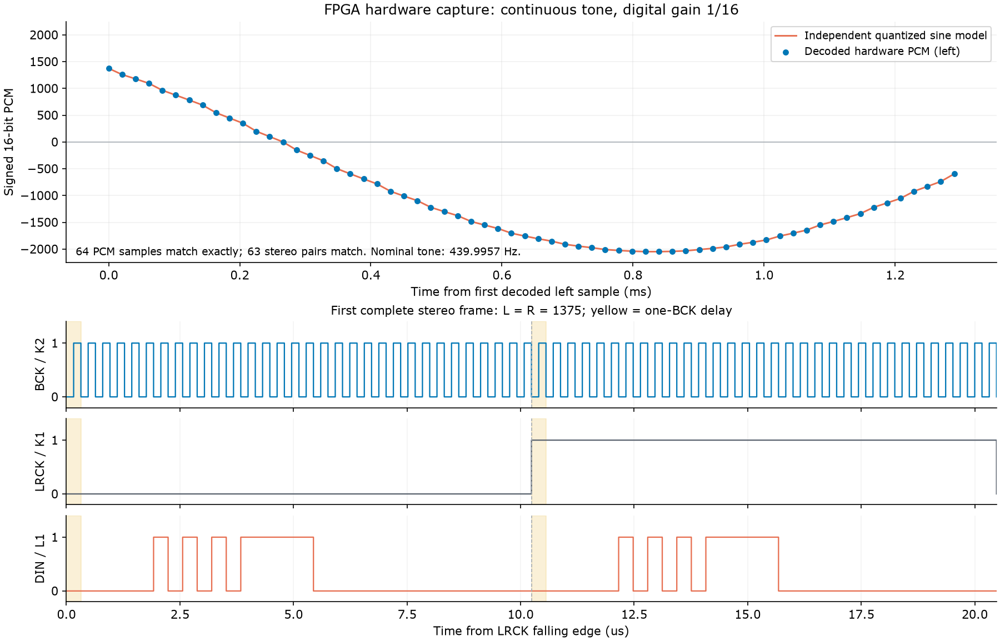

# 无需按键的自动播放诊断版

下载本目录的 `impl/pnr/ao_0.fs` 后，立即持续发送约 440Hz 的左右同声道正弦 PCM，
无需按住 S1。数字音量为 **1/16**。接收端正常时，应能听到持续的单音。

这个工程用来把按键使能与音频生成分开验证。它引用原工程的 `clk_div.v`、
`nco_sine.v`、`volume_key.v`、`i2s_tx.v` 和原来的 CST/SDC。
本目录 `src/top.v` 只把音频使能固定为 1、默认音量设为 1/16，并增加 H11 观测寄存器。
主工程的音频 RTL 没有修改。

## 已完成的板上检查：2026-10-08

Gowin 构建通过；官方 Programmer CLI 的 SRAM 下载完成，User Code=0x000051B2，
Status Code=0x70026020，记录在 `programmer_sram.log`。
随后通过 GAO 在 50MHz 时钟下采集 65,536 点，跨度 1.3107ms。

| 项目 | 实际解码结果 |
| --- | --- |
| BCK / K2 | 4,095 个完整周期均为 320ns，名义频率 3.125MHz |
| LRCK / K1 | 126 个完整周期均为 20,480ns，名义采样率 48.828125kHz |
| DIN / L1 | 有非零数据；捕获点中 17,632 点为 1，47,904 点为 0 |
| PCM | 64 个左声道采样，63 个非零；范围 -2048～1375 |
| 正弦模型 | 64 个采样逐点符合独立数学模型、相位增量 38,702,432 和 1/16 缩放 |
| 左右声道 | 63 对完整立体声采样全部相等 |
| I2S 格式 | 32 BCK/声道，一位延迟、16bit MSB 优先、补零检查通过 |
| 数据更新边沿 | DIN/LRCK 变化均对应 BCK 下降沿 |
| H11 | 观测寄存器始终为低，仍有音频数据，证明本版本绕过按键 |

检查器仅使用捕获的 BCK/LRCK/DIN 解码；正弦比较不读取硬件 NCO 寄存器或 RTL 波表。
未知起始相位通过区间交集求解，所有采样需要能匹配同一个连续相位序列。
约 439.9957Hz 按已验证的相位模型和板载 50MHz 标称值计算；GAO 没有独立测频。
这段捕获覆盖部分正弦周期，图中只画实际采到的数据。



结果文件：`captures/autoplay.csv`、`captures/autoplay_analysis.json`、
`captures/autoplay_waveform.png` 和 `captures/autoplay_waveform.svg`。

**本次确认了自动播放时正弦生成和 I2S 发送能在板上工作。原版实际按键使能、
DAC 接收端的外部电压和波形、模拟输出、功放与最终声音仍未完成实测。**

采集结束后已重新下载 `../audio_gao/impl/pnr/ao_0.fs`，恢复原来的按键行为：
按住 S1 播放，松开静音。当前板上没有持续自动播放。
原主工程正式位流没有改写，Flash 没有烧写。

## 回来后直接试听

在停止 GAO 采集后，在本目录执行：

```powershell
.\program_sram.ps1
```

脚本使用本机的 Gowin Programmer、USB Debugger A、Location 385，执行 SRAM 下载。
也可在 Programmer 图形界面选本目录 **`impl/pnr/ao_0.fs`**，使用 **SRAM Program**。
下载后无需按键。若听到测试音，说明这次配置下整个播放链路能出声；
再下载原按键版并按住 S1，可进一步检查原版按键使能。
若自动播放版仍无声，应检查实际 DAC 接收信号和模拟输出，不能仅凭片内数据判定声音正常。

重新构建时，在此目录执行 `gw_sh build.tcl`，或打开 `AUDIO_AUTOPLAY.gprj`。
复制工程时保留 `impl/AUDIO_AUTOPLAY_process_config.json` 和
`impl/project_process_config.json`，用于 CPU/SSPI GPIO 和 IOB 寄存器放置设置。
本工具版本使用 65,536 深度；更大的 131,072 深度在当前 GAO 生成器中未通过综合。

## 复核原始数据

GAO 打开 `AUDIO_AUTOPLAY.gao`，Start 后用 Force Trigger 获取数据。
Export 时设 **Clock period=20，单位=ns**，CSV 文件名带 `_core0` 后缀。
`key_s1` 显示的是 `key_observed`，约晚于 H11 输入一个 50MHz 时钟，且不控制音频。

```powershell
python verify_tone.py captures/autoplay.csv --output captures/autoplay_analysis.json
# 安装 matplotlib 的 Python 可用以下命令重画：
python plot_capture.py
```

本次位流 SHA256：

```text
E0D5207B1E6494FF30C8287C89AA7CEDB7BAE216543302744735CF00DA4875A8
```
