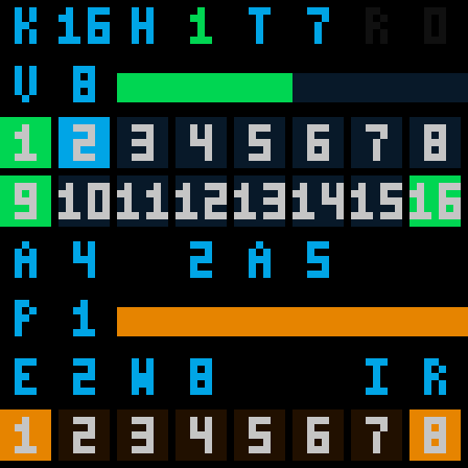

# FPGA 云端曲谱与实时演奏系统

基于 **Tang Primer 25K / GW5A-25A** 的实时音频合成工程：触摸、压力、红外和手势输入驱动 FPGA 合成声音，经 PCM5102 + PAM8403 输出；安卓 App 通过 HC-05 下载音符曲谱、调整音色和演奏参数，64×64 HUB75E 屏幕提供曲谱与音频可视化。

**当前唯一主工程：[pcm5102_pam8403/PCM5102_UNIFIED.gprj](pcm5102_pam8403/PCM5102_UNIFIED.gprj)**，顶层 `top_unified`，器件 `GW5A-LV25MG121NC1/I0`。请克隆整个仓库，主工程依赖 `pmod_hub75e/` 中的共享触摸模块。

**当前使用 App v1.24-hue / Code25**：安装入口为滚动的 [FPGA-Music-Unified.apk](pcm5102_pam8403/android_app/dist/FPGA-Music-Unified.apk)（2026-10-25 重新构建，SHA256 `40B92B82…`，含「板键联动」）；带版本号的 [FPGA-Music-Hue33-Code25.apk](pcm5102_pam8403/android_app/dist/FPGA-Music-Hue33-Code25.apk) 是 2026-10-23 的首个 Code25 构建，SHA256 `70059516…`，**不含板键联动**，两者 versionName 相同但字节不同，需要联动功能请装滚动入口。配套统一位流 `PCM5102_UNIFIED.fs`（当前默认构建为 2026-10-25 APDS 运算复用版，SHA256 `840AE4C4…`，本轮未记录 UserCode）：显示侧把 LED 波形的音量颜色从 8 档改为 **33 档青→蓝→紫→品红→红色环**，手机端「显示」分区顶部新增同色环的实时预览；音频侧新增 `KLIVE_ON` / `KLIVE_OFF` 板键实时联动与 **压力 + 滑杆双通道**（滑杆改用独立 I²C 上的 ADS1115，不再与 FSR 抢同一对 ADC 引脚）；此前保留弯音范围、滑音时间、共享颤音与起振等待、共享移调 / A4、84 / 168 / 336 / 504 ms 四档回声、`HOLD,2` 制音踏板、`POLY,n` 复音上限、16 键 C4～B4 半音阶与板上事件录制重放；本构建仍按用户授权关闭 FPGA Flash 原音 PCM 录制。当前资源、时序、SHA256 与验证范围见[验证记录](pcm5102_pam8403/VERIFICATION.md)，色环规则与标定见[LED 波形量程与色环](pcm5102_pam8403/SCOPE_DISPLAY.md)，双通道接线与 `CAL` 标定见[迁移说明](pcm5102_pam8403/REFERENCE_MIGRATION.md)，手机色环面板见[HUE33 说明](pcm5102_pam8403/android_app/HUE33.md)，效果器帧预算核验见[FX 前置核验](pcm5102_pam8403/FX_PREFLIGHT_20261024.md)，参数范围与资源预算见[演奏参数与四档回声](pcm5102_pam8403/PERFORMANCE_PARAMS.md)，键位表见[B1 半音阶说明](pcm5102_pam8403/CHROMATIC_KEYS.md)，连接失败时先按[HC-05 连接与超时定位](pcm5102_pam8403/HC05_CONNECTION.md)核对已安装版本。**混响 / 延迟 / 合唱三效果器的正式 RTL、兼容协议与新版 App 尚未交付**，当前只有隔离原型与预算核验。本轮交付仍止于仿真与构建：2026-10-25 位流未烧录、Code25 未在手机安装验证、未做耳机口对录与实体面板颜色核对；四档回声交付时点的 107 项 RTL 全量回归仍在运行，不计为全部通过。含 PCM 录制的 [2026-10-20 统一版交付包](pcm5102_pam8403/deliveries/UNIFIED_RECORDING_20261020/) 与[统一录制说明](pcm5102_pam8403/android_app/UNIFIED_RECORDING.md) 保留为历史版本，不含踏板、半音阶与演奏参数功能。旧工程与专用构建脚本已[归档](pcm5102_pam8403/archive/legacy_projects/README.md)；下文按日期保留的旧版功能、APK 和位流说明作为历史记录。

## 从这里开始

| 目的 | 文档或文件 |
| --- | --- |
| 首次下载、构建和使用 | [快速上手](docs/QUICK_START.md) |
| 查找全部功能文档 | [文档索引](docs/README.md) |
| 接线、板上操作与音频参数 | [主工程说明](pcm5102_pam8403/README.md) |
| 完整引脚、赛题要求和现场验收 | [引脚与功能验收表](pcm5102_pam8403/PIN_FUNCTION_REQUIREMENTS.md) |
| 手机安装和曲谱下载 | [App 说明](pcm5102_pam8403/android_app/README.md) · [当前安装包（滚动入口）](pcm5102_pam8403/android_app/dist/FPGA-Music-Unified.apk) · [手机色环频谱面板](pcm5102_pam8403/android_app/HUE33.md) · [侧边栏分区与状态](pcm5102_pam8403/android_app/SIDEBAR.md) · [连接与超时定位](pcm5102_pam8403/HC05_CONNECTION.md) |
| LED 波形读数 | [FSR 量程、33 档色环与 PK 标定](pcm5102_pam8403/SCOPE_DISPLAY.md) · [色环实际 RTL 对照图](pcm5102_pam8403/design/led_scope_20261023/hue33/hue33_verified.png) · [外观候选设计稿](pcm5102_pam8403/design/led_scope_20261022/README.md) · [音频可视化总说明](pcm5102_pam8403/AUDIO_VISUAL.md) |
| 压力与滑杆双通道接线 | [迁移说明](pcm5102_pam8403/REFERENCE_MIGRATION.md) · [FSR402 与片内 ADC](pcm5102_pam8403/FSR402.md) · [引脚与功能验收表](pcm5102_pam8403/PIN_FUNCTION_REQUIREMENTS.md) |
| 当前构建、位流标识和验证范围 | [验证记录](pcm5102_pam8403/VERIFICATION.md) · [33 档色环交付包](pcm5102_pam8403/deliveries/LED_HUE33_20261023/README.md) · [App 色环交付包](pcm5102_pam8403/deliveries/APP_HUE33_20261023/README.md) · [效果器帧预算核验](pcm5102_pam8403/FX_PREFLIGHT_20261024.md) · [演奏参数与四档回声](pcm5102_pam8403/PERFORMANCE_PARAMS.md) · [B1 半音阶键位表](pcm5102_pam8403/CHROMATIC_KEYS.md) |
| 更新代码到 Gitee | [仓库维护](docs/REPOSITORY.md) |
| 版本变化与升级要点 | [版本记录](docs/CHANGELOG.md) |

## 当前功能（2026-10-25）

- **压力 + 滑杆双通道模拟表情（2026-10-25）**：FSR402 继续走 GW5A 片内 ADC（J8/K8，22kΩ / 4.7kΩ 衰减到 0～1V）且始终有效；滑杆改接 **ADS1115 AIN1**（3.3V 供电、ADDR 接 GND、地址 0x48），并使用**独立 I²C 引脚** SCL=K10 / SDA=L10（J3 第31 / 32 脚），不再与 APDS-9960 共用总线，因此没有仲裁也没有分时。两路可同时生效：压力做音量或压音，滑杆单独做总音量、音高、颤音深度或音效湿度，`ANALOG,0` 现在只表示滑杆关闭，`CAL` 标定滑杆两端。赛题「≥3 维表情」由此拿到两条连续独立传感器轴，第三路仍缺，实物未测。新增 `ads1115_ctrl` 与 `i2c_master` 16 位寄存器写；`i2c_arbiter.v` 保留但不参与构建。
- **33 档整帧音量色环（2026-10-23）**：LED 波形页颜色改用独立的 PCM/64 色相轴，0～2048 共 33 档，180° 青经蓝、紫、品红到 360° 红，一帧内波形与总电平条共用一种颜色，±1 仍显示青色、只有零信号为灰色；量程保护、PK 百分比和电平条长度沿用原轴。实现只用限幅、移位、加减与取位，**不新增 ROM 表项、BSRAM、DSP 或硬件乘除单元**。手机端把同色环的实时预览放到「显示」分区顶部（App v1.24-hue），数据仍来自 `VIZ?` 的 0～31 频谱与 0～56 音源幅度，不冒充面板峰值。
- **板键实时联动 `KLIVE`（2026-10-24～25）**：`KLIVE_ON` / `KLIVE_OFF` 开启后，板子触摸键每次有效发声门变化上报一行 `K,<键号>,<1|0>`（键号 1～16，与 App 手机琴键扫描序一致），手机琴键同步点亮并在录制时直接写入当前录制；上行走 UART 复用且优先级最低，不插断命令应答，断开蓝牙自动复位。App 滚动入口的 1.24-hue 构建已含该开关，2026-10-23 的独立 Code25 包不含。
- **资源回收与效果器前置核验（2026-10-24～25）**：`apds9960_ctrl` 的局部累加 / 均值运算复用与两套音源的共享算术（`synth_shared_arith`）相对 10-25 冻结基线净回收 **211 Logic / 134 CLS**，当前默认位流为 Logic 21649、CLS 11183、BSRAM 47、DSP 26.5；`tb_fx_frame_budget` 在真实 50MHz / 1024 拍帧内实测触摸 1012、弯音 43、效果器 5 拍可并行，超限 / overrun / clipped 均为 0。三效果器（混响 / 延迟 / 合唱）只有隔离原型，正式 RTL、兼容协议与新版 App **未交付**，预算与逐项证据见[效果器前置核验](pcm5102_pam8403/FX_PREFLIGHT_20261024.md)和[验证记录](pcm5102_pam8403/VERIFICATION.md)顶部。
- **演奏参数与四档回声**：`PITCH`（弯音上下界与滑音斜率）、`VIB`（共享颤音速率 / 深度与整体起振等待）、`EFFECT2,tap`（84 / 168 / 336 / 504 ms 四档回声）三条新命令走 HC-05，长档只对湿声一阶低通并按 2 / 4 / 6 帧降采样，干声与原 84 ms 档保持原样；共享移调 / A4 只作用红外与手势，16 触摸键与吉他保持原音高；合唱速率维持原固定值，震音与律制未交付。App 提供按 BPM 就近选档，范围、公式与资源预算见[演奏参数与四档回声](pcm5102_pam8403/PERFORMANCE_PARAMS.md)。
- **新增迁移**：[8/16 键切换、16 键和弦、滑杆标定与四种用途、回声/合唱、延音、总音量和八种红外/手势音色](pcm5102_pam8403/REFERENCE_MIGRATION.md)。
- **现场演奏**：16 路独立触摸 DDS/ADSR（默认 8 键接口）、16 键串行按用户确认接线为 C4～B4 半音阶、K13～K16 暂作 C5/D5/E5/F5 四个高音条、FSR 压力音量或音高控制、八路红外与 APDS-9960 共享 32 声部 TDM 引擎，以及 Karplus–Strong 单弦吉他。键位表与实机测频待办见 [B1 半音阶说明](pcm5102_pam8403/CHROMATIC_KEYS.md)。
- **手机控制**：六分区侧边栏（参数区分草稿与设备确认三态）、手机钢琴键盘布局与七键图形映射、键位映射与 `MAP_RESET`、弯音范围 / 滑音时间 / 共享颤音与起振等待 / 共享移调与 A4 / 四档回声（含按 BPM 就近选档）参数卡片、七声部独立滑音、触摸与红外/手势独立运行时 ADSR、音色/颤音设置和演奏事件日志。侧边栏分区见 [App 侧边栏](pcm5102_pam8403/android_app/SIDEBAR.md)，新增命令字段见[键位与协议](pcm5102_pam8403/HC05_KEYMAP.md)。
- **当前通信仅HC-05**：曲谱、参数、LED控制/低速预览、踏板与复音设置及相应固件支持的事件/状态通信均走蓝牙。USB/RTS/OTG[高速音频方案保留备用，当前停用](pcm5102_pam8403/AUDIO_RECORDING.md)。当前踏板版按用户授权关闭板上 Flash 原音 PCM 录制以释放演奏资源，相关源码与含该功能的历史交付包保留。
- **制音踏板与复音上限**：`HOLD,2` 踩下踏板后松键进入约 1200 ms 四段有限尾音，抬起只对已松手音做约 10 ms 制音，按住键不受影响，再踩不重新起音且相位连续；`POLY,1/2/4/8/16` 是物理键优先的软上限，超限时最旧的已松手音逐个进入短释音。`CTRL2?` 回报真实模式、上限与实际声部数，原 `CTRL?` 保持七字段以兼容旧 App。踏板触发源仅为 App/HC-05，不新增引脚。
- **录制**：手机页面琴键录制（停止即回放、命名保存、导出 MIDI，不依赖蓝牙）与板上事件录制重放在同一固件中可用；事件录制暂不支持 `HOLD,2` 与非 16 上限，录制前需设为 `HOLD,0/1`、`POLY,16`，回放沿用原 528 位事件格式。新增的移调、颤音与回声参数不写入事件快照，录制与回放前需保持同一套参数。操作与限制见[录制说明](pcm5102_pam8403/android_app/UNIFIED_RECORDING.md)。
- **曲谱**：导入 CSV/MIDI，经经典蓝牙 SPP 下载音符、和弦、休止和时长。`PLAY` / S1 启动无声演奏指引；`AUDITION` 显式启动 FPGA 实时合成试听（自 App v1.3 起支持）。曲谱仍限前七键，16键演奏不会扩大曲谱格式。
- **64×64 LED，无需 OLED**：空闲总览显示 8/16 键、延音、音色、音量、压力 / 滑杆两路 ADC、音效与红外；播放时自动显示曲谱。保留实际混音波形、参考/混音 XY、FFT。S2 长按约 1 秒切页；XY 页短按选图，其他页短按重启曲谱。
- **LED 波形页量程与颜色（2026-10-22 量程 / 2026-10-23 色环）**：波形完整覆盖 512 个采样、约 10.486ms，48 列带时间轴与数字幅度刻度；建议量程随 FSR 音量增益取 X8 /X16 /X32（纵轴 ±4K /±2K /±1K，K=1024），混音超出时自动扩到 X4 /X2 /X1。静音才显示低亮白；非零峰值颜色自 2026-10-23 起改用 PCM/64 的 33 档色环（青→蓝→紫→品红→红，2048 计数及以上钳红），一帧内波形与总电平条同色。量程保护、PK 与电平条保持 0～100% 固定满幅刻度。三音源幅度条保留在 XY /FFT 页，未新增 App 命令、DSP 或音频处理级，也不是自动增益。读数与标定见 [LED 波形说明](pcm5102_pam8403/SCOPE_DISPLAY.md)，实际 RTL 逐像素对照见[色环输出图](pcm5102_pam8403/design/led_scope_20261023/hue33/hue33_verified.png)，外观候选见[设计稿](pcm5102_pam8403/design/led_scope_20261022/README.md)。

曲谱、参数保存在 FPGA RAM，断电需重新设置。新增 [v1.8 分级曲库安装包](pcm5102_pam8403/android_app/dist/FPGA-Score-library.apk)，青铜、白银、黄金各三首，可离线选曲并匹配七键下载，保留文件夹 CSV/MIDI 导入及曲库 CSV 导出；来源、七键改编和验证范围见[曲库说明](pcm5102_pam8403/android_app/SONG_LIBRARY.md)。尚未接入在线更新服务。默认上电不自动演奏，音频由 FPGA 逐样本生成。

当前使用 **App v1.24-hue / Code25**，配套统一位流 `PCM5102_UNIFIED.fs`（当前默认构建为 2026-10-25 APDS 运算复用版，Logic 21649 / CLS 11183 / BSRAM 47 / DSP 26.5，50MHz 时序通过，SHA256 `840AE4C4…`，本轮未记录 UserCode、未烧录）；正常演奏、曲谱、LED 遥控/预览、FSR 联动量程波形显示与 33 档色环、`HOLD,2` 制音踏板、`POLY,n` 复音上限、演奏参数与四档回声、`KLIVE` 板键联动、压力 / 滑杆双通道与板上事件录制重放在同一固件中，无需按功能换烧。安装入口为滚动的 [FPGA-Music-Unified.apk](pcm5102_pam8403/android_app/dist/FPGA-Music-Unified.apk)（1.24-hue，含板键联动），同版本号的 [FPGA-Music-Hue33-Code25.apk](pcm5102_pam8403/android_app/dist/FPGA-Music-Hue33-Code25.apk) 是 2026-10-23 的首个 Code25 构建、不含板键联动，两者字节不同；上一版连接诊断 [FPGA-Music-LinkDiag-Code24.apk](pcm5102_pam8403/android_app/dist/FPGA-Music-LinkDiag-Code24.apk)、半音阶 [FPGA-Music-Chromatic.apk](pcm5102_pam8403/android_app/dist/FPGA-Music-Chromatic.apk) 与更早 [FPGA-Music-Pedal.apk](pcm5102_pam8403/android_app/dist/FPGA-Music-Pedal.apk) 继续保留，其余 `dist/` 链接对应的安装包可从 Gitee 提交记录取得。色环位流交付包见 [LED_HUE33_20261023](pcm5102_pam8403/deliveries/LED_HUE33_20261023/README.md)（UserCode `0x00002176`，已被 10-25 构建取代为默认输出），App 色环交付包见 [APP_HUE33_20261023](pcm5102_pam8403/deliveries/APP_HUE33_20261023/README.md)，10-25 两次构建的输入指纹与逐项资源账记录在[验证记录](pcm5102_pam8403/VERIFICATION.md)顶部及 `reports/` 本地快照；更早的 [LED_SCOPE_WEAK_FIX_20261022](pcm5102_pam8403/deliveries/LED_SCOPE_WEAK_FIX_20261022/README.md)、[LED_SCOPE_20261022](pcm5102_pam8403/deliveries/LED_SCOPE_20261022/README.md) 与四档回声功能基线 [ECHO_PRIORITY_20261022](pcm5102_pam8403/deliveries/ECHO_PRIORITY_20261022/README.md) 保留为历史（该冻结包内的 Code22 APK 有握手缺陷，不要从中安装），Code24 单独交付见 [HC05_CONNECTION_20261022](pcm5102_pam8403/deliveries/HC05_CONNECTION_20261022/README.md)，被取代的 C7 全覆盖候选见 [PERFORMANCE_PARAMS_C7_20261021](pcm5102_pam8403/deliveries/PERFORMANCE_PARAMS_C7_20261021/README.md)。LED 切页/预览功能页见[v1.10 说明](pcm5102_pam8403/LED_REMOTE.md)，事件录制回放开发说明见[录制回放](pcm5102_pam8403/RECORD_PLAYBACK.md)。本轮构建的资源、时序、SHA256 与未完成的实板项见[验证记录](pcm5102_pam8403/VERIFICATION.md)顶部、[效果器前置核验](pcm5102_pam8403/FX_PREFLIGHT_20261024.md)和[演奏参数与四档回声](pcm5102_pam8403/PERFORMANCE_PARAMS.md)；含 PCM 录制的更早版本结果保留在[RAM 几何优化与统一版验证](pcm5102_pam8403/RAM_GEOMETRY_VERIFICATION.md)。



上图由 HUB75E 输出引脚仿真重建，屏幕标签含义见 [状态页图例](pcm5102_pam8403/REFERENCE_MIGRATION.md)。

## 工程目录

| 目录 | 定位 |
| --- | --- |
| [pcm5102_pam8403/](pcm5102_pam8403/README.md) | 当前音频、传感器、LED 与安卓 App 主工程 |
| [pmod_hub75e/](pmod_hub75e/readme.md) | 独立显示/触摸工程；同时提供主工程依赖的共享输入模块 |
| [ttp229_gpio/](ttp229_gpio/README.md) | TTP229 直连接口独立验证 |
| [ttp229_serial16/](ttp229_serial16/README.md) | TTP229 固定 16 键串行接口独立验证 |
| [hc05_uart_echo/](hc05_uart_echo/README.md) | HC-05 UART 回显与接线验证 |
| [pcm5102_dds_step1/](pcm5102_dds_step1/README.md) | 历史单声部 DDS 验证快照 |
| [ALL_IN/](ALL_IN/README.md) | 手势/吉他融合前的历史参考工程 |
| `1-2-4-按键控制LED程序/` | STM32 按键控制 LED 参考工程 |
| [docs/](docs/README.md) | 仓库文档导航、快速上手与维护说明 |

独立屏幕工程的双模式说明见 [MODE_SELECTION.md](MODE_SELECTION.md)。历史工程的引脚、位流和操作不适用于当前主工程；请按各目录说明使用。

## 获取代码

```powershell
git clone https://gitee.com/yxy0818/cloud-audio-based-on-fpga.git
cd cloud-audio-based-on-fpga
```

仓库保存源码、约束、工程配置、测试、文档、App 安装包，以及 `pcm5102_pam8403/deliveries/` 中已验证的交付包（位流、APK 与报告）。日常构建输出 `impl/`、仿真日志 `sim/build/`、SDK、工具安装包及重复压缩包不入库，`pcm5102_pam8403/reports/` 每轮审计只入库报告正文与指纹数据，其下的综合 / PnR 快照树和起始补丁留在本机，需按 [快速上手](docs/QUICK_START.md) 在本机生成；重新构建的指纹可能与交付包不同。
