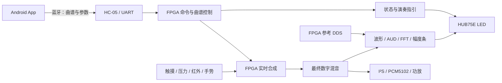

# LED 视觉功能与手机 App 联动整理

整理日期：2026-10-19。适用于当前主工程 `PCM5102_PAM8403.gprj`、顶层 `top`，以及仓库内 Android App 源码。

结论：LED 演奏指引、李萨如图形、实时频谱、波形显示均已有 FPGA 实现。[App v1.9](android_app/LED_CONTROL.md)提供六个 XY 预设与频率比/相位控制；后续 [App v1.10 与配套 FPGA 位流](LED_REMOTE.md)已加入手机切页、实际显示状态读回，以及频谱和音源幅度预览。

下表“已有”表示源码已经接入并有数字仿真记录；实体面板、手机与完整声音链路仍需联合验收。v1.10 已生成 App 和配套 FPGA 位流，没有自动烧录开发板。

## 1. 当前 LED 能显示什么

现有硬件为 64×64、1/32 扫描的 HUB75E RGB 面板，各色 5 位 PWM。

| 功能 | 视觉反馈与用途 | 数据来源 | 当前范围 |
| --- | --- | --- | --- |
| 演奏状态总览 | 键态、8/16 键模式、音量、音色、延音、音效、滑杆/ADC、红外状态 | FPGA 当前控制参数和输入状态 | 已有；空闲时显示，App 已支持部分参数设置 |
| LED 演奏指引 | 七轨下落音符、到时目标、实际按键反馈；支持和弦与休止 | 手机下载到 FPGA RAM 的音符事件，以及实际触摸键态 | 已有；曲谱最多 128 段，指引对应前七键；尚无计分、命中判定或长音尾条 |
| 波形显示 | 观察声音起音、包络、音色及混音变化 | 与 I²S 输出锁存相同的最终数字混音采样 | 已有；64 列，每列保留 8 个采样的最小/最大值，一段约 10.486ms；不是连续录音 |
| 参考李萨如 REF | 八字、多瓣、圆、椭圆、直线，演示频率比和相位关系 | FPGA 两路相干正弦 DDS | 已有；X:Y 为 1:1、1:2、2:3，相位差为 0°、45°、90°、135°；不随现场声音自动变化 |
| 混音延时 XY / AUD | 随演奏变化的音频轨迹 | 当前最终混音与延后 32 个采样的同一混音 | 已有；固定延时 655.36µs，属于单信号延时轨迹，不能称为左右声道独立测相 |
| 实时频谱 | 16 段频谱柱，观察音高、谐波和混音变化 | 最终混音经低通、8 倍降采样、Hann 窗和 256 点 FFT | 已有；显示约 0～3.05kHz，每秒约 23 次分析结果更新；不是全音频带宽或声压测量 |
| 三组音源幅度条 | 触摸、红外/手势、吉他的强弱与衰减 | 三组音源的采样 | 已有；位于波形、XY、频谱页下半屏，红外与手势合并显示 |

LED 扫描刷新约 367Hz，FFT 分析约 23 次/秒，两者含义不同。显示通过缓冲区在完整 PWM 帧边界更新，音频继续逐样本运行。

波形和 FFT 观察的是送入 DAC 前的数字采样，不包含功放、扬声器或房间声学的变化。REF 是数学参考图形；需要“随演奏变化”的 XY 效果时，应选 AUD。

## 2. 手机与 FPGA 的分工

App 负责选曲、配置和交互；FPGA 负责实时声音、图形计算和屏幕扫描。已提交的曲谱在蓝牙断开后仍可由板上按键控制，掉电后 RAM 曲谱与运行时设置丢失。

现有 App 使用经典蓝牙 RFCOMM/SPP，属于 Android 官方支持的通信方式，见 [Android BluetoothSocket 文档](https://developer.android.com/reference/android/bluetooth/BluetoothSocket)。本方案首先复用现有 Android + HC-05 链路；其他手机平台需要另行核对连接方案。

### 现有操作已经能完成的联动

1. 手机连接 HC-05，选择曲谱并下载，等待提交成功。
2. 点击 `PLAY`，FPGA 显示七轨演奏指引；演奏者触摸按键，FPGA 同时生成声音与按键反馈。普通 `PLAY` 本身不自动发声。
3. 长按板上 S2 约 1 秒，在“总览/曲谱 → 波形 → XY → 频谱”间循环；曲谱在隐藏期间继续计时。
4. XY 页短按 S2 可依次选择八字、多瓣、圆、椭圆、直线和实际混音；其他页短按 S2 会重启有效曲谱。
5. App 改变已有音量、音色、ADSR、音效或音高参数后，相关音频变化会反映在波形、AUD、频谱和幅度条中；REF 仍由自己的频率比与相位参数决定。

App 的 `AUDITION` 是显式启动 FPGA 根据音符事件实时合成试听，和人工跟随指引演奏是不同操作。当前 App 标题旁的 `BeatBarsView` 只是固定装饰图案，不能当作已经接收 FPGA 实时频谱的证据。

## 3. 建议补充的 App 操作

| 建议控件 | 用户操作 | 是否需要 FPGA 改动 |
| --- | --- | --- |
| 李萨如预设（App v1.9 已加入） | 八字、多瓣、圆、椭圆、直线、实际混音六按钮 | 参数设置无需新增 RTL，复用 `XY,r,p`；当前仍需 S2 进入 XY 页 |
| 频率比 / 相位选择（App v1.9 已加入） | 选择 1:1、1:2、2:3 和四种相位 | 参数设置无需新增 RTL，复用 `XY,r,p` |
| 显示页选择（v1.10 已加入） | 总览/曲谱、波形、XY、频谱四按钮 | 新增 `VIS,n` 协议，接入现有模式控制器 |
| 设备显示状态（v1.10 已加入） | 显示实际页面、REF/AUD、频率比和相位 | `VIS?` 区分请求值与帧锁存值；预览时同步实际状态 |
| 手机实时预览（v1.10 已加入） | 手机显示 FPGA 生成的频谱柱与音源幅度 | `VIZ?` 回传固定 32 字节快照，App 最多每秒查询 5 次 |
| 颜色、亮度、波形缩放 | 按使用环境或音量调节显示 | 需要新增参数和 RTL 支持，作为后续选项 |

### 可直接复用的现有命令

每条以 CRLF 结束，合法设置回复 `OK`；参数越界或格式错误会拒绝，且不修改原设置。

| 发送内容 | 效果 |
| --- | --- |
| `XY,2,0` | 参考八字：1:2、0° |
| `XY,3,0` | 参考多瓣：2:3、0° |
| `XY,1,2` | 参考圆：1:1、90° |
| `XY,1,1` | 参考椭圆：1:1、45° |
| `XY,1,0` | 参考直线：1:1、0° |
| `XY,0,0` | 现场混音延时 XY |

命令只改变 XY 参数，不自动切页。App v1.9 已提供专用 XY 控件；也可使用蓝牙串口终端发送，或直接在板上用 S2 选预设。App 显示最近确认发送值，没有读取设备实时状态。

### 远程切页与查询（v1.10 已实现）

已新增 `VIS,0`～`VIS,3`，分别请求总览/曲谱、波形、XY、频谱，并新增 `VIS?` 状态查询和 `VIZ?` 数据快照。需要使用配套新版 FPGA 位流；完整格式见 [手机 LED 联动协议](LED_REMOTE.md)。

`VIS,0` 复用当前自动规则：空闲显示总览，曲谱运行显示指引。命令复用现有串口队列、错误回复和整帧切换机制；查询区分请求与实际显示。同周期手机切页优先于 S2，并抑制该次按住剩余动作。整机仿真检查切页期间曲谱与 I²S 连续。

## 4. 手机同步预览与带宽

HC-05 当前 UART 为 9600bps、8N1，单方向理论上限约 960 字节/秒，还要考虑命令回复与事件日志占用。

v1.10 已回传 16 个频段柱高、三组幅度和实际页，不传整幅图像。每次回复结束后至少等待 200ms，最多每秒查询 5 次；上行理论预算 160 字节/秒，下载、事件日志录制及其他命令执行期间暂停预览。这些频谱结果仍由 FPGA 计算。

作为量级对比：64×64 RGB565 单帧为 8192 字节，每秒 10 帧需 81920 字节；当前 16 位单声道原始混音每秒约 97656 字节，均超出现有 9600bps 链路能力。

如需在手机显示更细的实时波形，可以评估已有的独立 2Mbps USB 串口 / OTG 数字混音回传，再增加 App 绘图。此链路的接收与 WAV 导出已有实现及数字验证，但高速模块、RTS、OTG 和持续吞吐仍待实板验证，详见 [数字录音说明](AUDIO_RECORDING.md)。

如果目标是“手机播放任意音乐，LED 跟着音乐变化”，当前曲谱下载功能不能直接做到。还需要新增手机音频传输或外部音频采集通路；PCM5102 是 DAC，不能承担音频输入采集。该需求应单独设计和评估资源。

## 5. 实施顺序与可操作性

1. **App 六个 XY 预设与参数选择已落实。** v1.9 复用现有 `XY` 协议，界面提示用 S2 进入 XY；APK 与 JVM 测试通过，待手机/面板联调。
2. **远程切页和状态读回已实现。** v1.10 复用现有四页渲染与扫描，不新增 FFT 或整屏缓存；RTL 与 50MHz 布局布线通过，手机实物联调待验。
3. **低速手机预览已实现。** v1.10 使用限速查询，原子回传帧数据；超时清除旧图，切后台或断开后停止，实际手机与蓝牙链路待验。
4. **最后考虑外观扩展与外部音乐输入。** 单独核算资源与带宽，不把这些扩展列为当前已完成项。

本次配套位流已完成 50MHz 综合与布局布线，沿用同期日志/曲谱资源优化，并分时复用回复编码器；CLS 仍接近容量。具体资源、时序与产物指纹见 [验证记录](VERIFICATION.md)。后续增量仍需重新评估，不能从本次通过推断大型扩展也能容纳。

建议联合验收：手机下载并启动指引 → 实际演奏并核对键态 → 切换波形/频谱观察声音变化 → 比较 REF 和 AUD → 断开手机确认板上继续运行。后续开发远程切页时，还需检查本地 S2 并发、非法命令、状态读回和切页不影响 I²S。

## 6. 可用于方案书的功能表述

> 系统基于 FPGA 硬件逻辑实时生成 LED 可视化反馈，包括七轨演奏指引、最终混音波形、参考李萨如图形、混音延时 XY 轨迹、实时 FFT 频谱和多音源幅度条。Android App 通过蓝牙下载音符曲谱、设置演奏与图形参数、切换 LED 页面并读取设备状态，同时接收 FPGA 计算的频谱和音源幅度作手机实时预览。FPGA 独立完成声音合成与 LED 显示。

“已实现”可描述上述 FPGA 视觉功能、曲谱/参数联动、手机远程切页与低速预览；命中计分、任意手机音乐驱动仍待开发。完整整机可用性以实板验收为准。

依据：[音频可视化](AUDIO_VISUAL.md)、[演奏指引](RHYTHM_GUIDE.md)、[App 说明](android_app/README.md)、[构建与验证记录](VERIFICATION.md)，以及 `src/top.v`、`src/display_mode_control.v`、`src/hc05_keymap.v`、`src/audio_visualizer.v`、`src/audio_spectrum.v` 与 App 源码。
