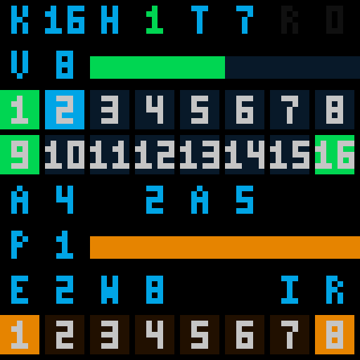

# 参考工程功能迁移：App v1.4 / 8、16 键演奏

> 2026-10-26 固定十六键：当前统一工程上电即串行十六键，删除八键输入和 App 切换入口。`TOUCH,8` 返回 `ERR,RANGE`；键盘未就绪时可在空闲状态用 `SERIAL,0/1` 修正极性。以 [当前操作与协议](TOUCH16.md) 为准；下文八键及旧版构建说明保留历史用途。


基于本机 `xqr/fpga-musical-magic-box-master/1/fpga_project_1`，修改当前
`PCM5102_PAM8403.gprj`，顶层仍为 `top`。保留 PCM5102、PAM8403、HC-05、
HUB75E、原 FSR ADC、红外和 APDS-9960 的现有接口。硬件由用户改接；本次不自动烧录。
最新构建指纹与验证结果见 [VERIFICATION.md](VERIFICATION.md)。

当前采用App v1.11 / Code12，仅通过HC-05通信；本页保留v1.4引入的迁移功能说明。[2Mbps USB音频回传](AUDIO_RECORDING.md)保留备用、当前停用，无需USB模块、RTS或OTG。原REC事件日志限制不变，板上事件录制回放的独立目标见[说明](RECORD_PLAYBACK.md)。

## 手机使用

安装[当前v1.11 HC-05通信版APK](android_app/dist/FPGA-Score-hc05-only.apk)，使用支持所需演奏/LED命令的配套FPGA位流。
连接后自动读取七键映射、演奏参数、串行极性和滑杆标定。界面“键盘模式与演奏控制”中：

1. 松开全部键，停止曲谱，关闭延音锁存；选择 8 键或 16 键，点击“应用”。
2. 16 键时先让“串行极性”匹配模块 TP1/SAHL：低有效对应参考工程的 TP1 开路；
   高有效可用于已装 TP1 跳帽的模块。先在 8 键模式应用极性，再进入 16 键。
3. 配置/接线完成后给触摸模块重新上电。FPGA 进入串行模式会等待约 600ms，再确认完整帧。
   校准时保持松键；校准期间按住的键需先释放再重按。
4. 8 键保留 K1～K7 演奏、K8 切换压力用途；16 键全部 K1～K16 都演奏，
   压力音量/音高改用手机“应用压力用途”。
5. 音效选择原声、回声或合唱，湿度 0～8；总音量 0～16，0 为静音。
   选择和拖动只是草稿，点击应用且收到确认、读回后才显示为设备状态。
6. 延音锁存开启后，松键仍保持已按音符；关闭后进入正常释音。
   `PANIC` 停止曲谱、关闭锁存、清除音源和音效尾音；按住的实体键须松开重按。

设备忙时切模式会返回 `ERR,BUSY`，不会强制改变正在演奏的输入。
若串行接线/极性不匹配导致键盘始终未就绪，切模式也会被拒绝；给 FPGA 重新上电恢复默认 8 键后，先修正接线并应用极性，再进入 16 键。
现有 SPP 传输遇到设备错误会关闭连接，处理提示后重连即可。
普通 `STOP` 只停止曲谱；需要释放锁存或现场声音时使用 `PANIC`。
设置保存在 RAM，FPGA 断电后恢复 8 键、低有效串行、原声和正常音量。

## 已迁移的功能

| 功能 | 当前实现 |
| --- | --- |
| 8/16 键切换 | App 控制并查询实际模式；8 键直连、16 键 SCL/SDO 串行 |
| 完整 16 键和弦 | 16 个独立 DDS 相位、ADSR 和门控，共享运算和窄 RAM；不限制单键 |
| 串行抗干扰 | 参考驱动的双窗口 75% 投票、两帧一致确认、失联超时释放；增加两种极性适配 |
| 高音键 | K8～K16 固定自然音 C5～D6，与参考工程一致 |
| 八种红外/手势音色 | 正弦、钢琴、长笛、尤克里里、鼓、电钢琴、钟声、弦乐 |
| 回声、合唱 | 移植参考 `audio_effects`，全局混音后处理；回声缓冲改为 4096 样本以适配本机资源 |
| 总音量 | 移植参考 `audio_master_volume`，音频帧上平滑，最大为原始增益 |
| 延音 | 改为 App 可控锁存，配合关闭释音和 PANIC |
| 滑动变阻器 | 新增真实 ADC 控制链路和端点标定，支持总音量、触摸音高、触摸颤音深度、音效湿度 |
| 64×64 状态页 | 空闲显示键盘、延音、音色、录制、音量、16 键、ADC/标定行程、压力、音效、8 路红外；曲谱页仍有 16 格键态 |
| 状态与诊断 | 手机读取实际控制状态、串行极性、原始 ADC 和滑杆标定 |

参考工程的部分说明明确写着“滑动变阻器模拟采集尚未接入”。本次滑杆功能是在目标工程原有 ADC 上新增，
不是复制一份已经完成的参考滑杆驱动。HUB75E 已有的波形、XY、FFT、下载谱和自动试听继续保留。

## 键位和兼容范围

| 键 | 默认音符 | MIDI | 配置 |
| --- | --- | --- | --- |
| K1～K7 | C4 D4 E4 F4 G4 A4 B4 | 60,62,64,65,67,69,71 | 原 MAP 和七个独立滑音仍可用 |
| K8～K16 | C5 D5 E5 F5 G5 A5 B5 C6 D6 | 72,74,76,77,79,81,83,84,86 | 固定音高，共享压力/滑杆变调和触摸 ADSR |

触摸仍是正弦音源，八种音色作用于红外/手势。K8～K16 音量比前七键低一档，给 16 键和弦留混音余量。
ADSR 修改影响后续新音，已按音保留各自包络快照；变调保持相位连续。
触摸门控现在在音频帧上采样，相比原独立运算增加至多一个约 20.48µs 的门控采样等待。

现有曲谱 CSV/MIDI、下载协议、自动试听、七列下落指引仍只使用前七键，支持 MIDI60～72；
本次没有扩大曲谱格式为 16 键，也没有增加 K8～K16 的独立手机滑音控件。
事件日志格式仍为七键/FSR；16 键、锁存或滑杆模式下拒绝 `REC_START`，避免导出被误认为完整的演奏日志。音效、总音量、ADSR 和独立滑音参数仍不写入事件日志，不能据此完整重放音频。

TFT/FT6336 触摸屏、OLED、74HC595 指示灯、ADS1115 外部压力 ADC、参考工程的自动/跟奏引导页面未移植；
这些涉及额外外设，当前继续使用本工程的点阵屏和片内 ADC。没有新增完整混响或录音播放器。

## 64×64 LED，无需 OLED

默认页在空闲时显示演奏总览，下载谱播放/试听时自动显示原七列下落指引，停止后返回总览。
长按 S2 约一秒，依次切换“总览/曲谱 → 波形 → XY → FFT → 总览/曲谱”；
短按 S2 的原重启曲谱/XY 参考图形操作保留。其他图形页不会被状态页强制抢占。
所有状态在完整 RGB5 PWM 帧边界一起更新，按键显示的额外刷新等待小于约 2.724ms。

点阵字体为 3×5，数字 10～16 在同一格内并排显示，避免占用额外屏幕。标签如下：

| 屏幕行（从上到下） | 显示内容 |
| --- | --- |
| 1：`K16 H1 T7 R0` | K：8/16 键；H：延音锁存；T：红外/手势音色 0～7；R：事件录制 0/1。K 红色表示键盘校准未就绪 |
| 2：`V12`＋绿条 | V 为手机音量上限 0～16；绿条是滑杆约束后的目标总增益，0～原始增益，不是 PCM 波形强度 |
| 3～4：`1…16` | 绿底为实体键按下，青底为锁存/自动试听门控，深蓝底为空闲。8 键模式的 K8 是黄色压力用途键，K9～16 灰暗 |
| 5：`A4 2A5` | A：模拟用途 0 FSR、1 音量、2 音高、3 颤音、4 湿度；后三位是原始 10 位 ADC 十六进制值。ADC 超时/过期时 A 和 `!` 变红 |
| 6：`P1`＋黄条 | P：原 FSR 音量/音高选择 0/1，在 A0 时生效；黄条为按标定端点归一化的 ADC 行程，标定不改变原 FSR 曲线。ADC 失效时整条变红 |
| 7：`E2 W8 IR` | E：0 原声、1 回声、2 合唱；W：当前实际湿度 0～8，可随 A4 滑杆变化；IR 提示下一行为红外 |
| 8：`1…8` | 8 路红外遮挡状态，黄色为被遮挡。音色 T 作用于红外/手势，触摸键仍为正弦 |

下图由仿真的 HUB75E 实际输出引脚重建完整 32 个 PWM 平面，按整数倍放大；是数字预览，不是实板照片。



状态字体使用同步块 ROM，原有 64×64 RGB5 扫描、七列曲谱、波形、XY 和 FFT 保留，工程没有 OLED 依赖。
红外输入保留上拉，未接模块时会显示为遮挡；没有先检测到稳定通光的通道不会触发声音。

## 硬件改接

8 键原 OUT 接线不变。16 键使用：

| 信号 | FPGA 球号 | Dock 位置 |
| --- | --- | --- |
| TTP229 SCL | F6 | J3 第 37 脚，FPGA 输出 |
| TTP229 SDO | F7 | J3 第 38 脚，FPGA 输入 |
| VCC / GND | 3.3V / 共地 | 沿用原供电 |

串行是 TTP229 两线协议，不是 I²C。进入串行前必须拆除 SCL 到 GND/3.3V 的固定连接。
16 键模式下 OUT1～OUT8 复用为电极，**必须断开原 OUT 线**，只连接串行信号。
FPGA 保留原八路输入的内部下拉，使拆掉 OUT 线后默认 8 键模式仍保持静音、可通过 App 切到 16 键。
若把这些下拉输入继续连在模块 16 键电极上，会加载电极而影响触摸检测。
模块 KYSEL/TP2 和多键选项仍由硬件配置并在模块上电时锁存，App 不会修改这些焊盘。
不同模块焊桥可能已串联高值配置电阻，应按实际模块说明配置，不把触摸电极直接短路接地。

### 滑动变阻器（与压力通道独立）

压力传感器继续使用片内 ADC：J8 / J3 第 36 脚为模拟输入 A，K8 / J3 第 35 脚为参考 B、接 GND，
AO 经 22kΩ/4.7kΩ 衰减到 0～1V。**这一路不再受“滑杆模式”影响，任何时候都参与压力音量/音高。**

滑杆改接 ADS1115 的 AIN1，**用独立的一组 I²C 引脚**，不与 APDS-9960 共用总线：

```text
滑杆两端 ── 3.3V / GND
滑杆中点 S ── ADS1115 AIN1（直接接，不用 22k/4.7k 分压）
ADS1115 VDD ── 3.3V
ADS1115 GND ── FPGA GND
ADS1115 ADDR ── GND（地址 0x48）
ADS1115 SCL ── K10 / J3 第 31 脚（独立总线）
ADS1115 SDA ── L10 / J3 第 32 脚（独立总线）
```

ADS1115 由 FPGA 配置为 AIN1 单端、±4.096V 量程、连续转换 128SPS、比较器关闭；
FPGA 每 10ms 读一次转换结果。16 位结果右移 5 位映射到 10 位（0～1023），
3.3V 满行程约 825，实际两端用 `CAL` 标定（跨度至少 32），例如 `CAL,0,820`。
ADS1115 供电 3.3V 时模拟输入不得超过约 3.6V，滑杆由同一 3.3V 供电，天然满足；不要把 5V 信号接进来。
模块若自带 10kΩ 上拉可直接使用；裸芯片必须给 SCL/SDA 各加 4.7kΩ～10kΩ 上拉到 3.3V，FPGA 内部上拉只作辅助。
ADDR 必须接 GND（地址 0x48）；有的模块用焊桥或跳线选择地址，接线前先确认。

滑杆转换器独占一组 I²C：`slider_scl`=K10（J3 第 31 脚）、`slider_sda`=L10（J3 第 32 脚），
APDS-9960 仍用 H4/G4（J3 第 23/24 脚），两条总线互不影响，也不再需要总线仲裁。
滑杆用途如下，`ANALOG,0` 现在表示“滑杆关闭”，压力通道仍然有效：

| App 用途 | 实际作用 |
| --- | --- |
| 0：关闭滑杆 | 不使用滑杆；压力音量/音高照常 |
| 1：总音量 | 滑杆 0～原始音量，并受手机总音量上限约束，作用于全部音源 |
| 2：触摸音高 | 连续 0.5～1 倍频率，叠加前七键独立滑音，作用于全部触摸键 |
| 3：颤音深度 | 约 5.96Hz 的三角形周期变调，以压力音高为基准，滑杆控制深度 |
| 4：音效湿度 | 0～8 档；需先选择回声或合唱 |

滑杆通道超时（约 100ms 没有新的有效样本，例如 ADS1115 未接或总线异常）时，
回到手机音量上限、标准音高和手动湿度；压力通道不受影响。
`ANALOG,0` 时手机的 ADC 读数显示压力通道，`ANALOG,1～4` 时显示滑杆通道，便于分别标定。

## 新增串口协议

原 9600、8N1、ASCII+CRLF 和一次一条确认规则保留。

```text
TOUCH,8 / TOUCH,16       -> OK       切输入，空闲且关闭锁存时可用
SERIAL,0 / SERIAL,1      -> OK       低 / 高有效串行，切换限制同上
SERIAL?                 -> SERIAL,0
EFFECT,0..2,0..8         -> OK       原声 / 回声 / 合唱，湿度
VOLUME,0..16            -> OK       总音量，0 静音
HOLD,0 / HOLD,1 / HOLD,2 -> OK       普通释音 / 原无限锁存 / 钢琴制音踏板
PRESSURE,0 / PRESSURE,1  -> OK       FSR 音量 / 音高
ANALOG,0..4             -> OK       模拟输入用途
CAL,0,590               -> OK       滑杆 ADC 最小、最大端点，十进制
CAL?                    -> CAL,000,24E   三位十六进制端点
ADC?                    -> ADC,24E,0     三位十六进制原始值，最后一位=超时
CTRL?                   -> CTRL,1,2,4,0,3,16,0
PANIC                   -> OK       停谱、关锁存、释放音源及音效
TONE,0..7               -> OK       八种红外/手势音色
```

`CTRL` 七个字段依次是：16 键标志(0/1)、音效(0～2)、湿度(0～8)、延音启用标志(0/1，踏板也回报1)、
模拟用途(0～4)、手机音量(00～16)、FSR 音高标志(0/1)。音量有两位前导零。
`CTRL` 回报的是手动设置，滑杆模式下实际音量/湿度会随 ADC 变化。
非法数字返回 `ERR,RANGE`，格式错误返回 `ERR,CMD`，禁止修改返回 `ERR,BUSY`，均不提交该命令。

## 验证和上板检查

本次数字验证范围以 [验证记录](VERIFICATION.md) 顶部为准，不能代替模块焊盘、实际误触、模拟声音和整机延迟实测。
建议硬件改好后依次检查：8 键原操作 → 两种串行极性中实际使用的一种 → K1/K8/K16 单键 →
低高音跨组和弦 → 全键松开 → 延音及 PANIC → 滑杆两端标定 → 四种用途 → 回声/合唱 →
八种红外/手势音色 → 原曲谱下载、指引、自动试听和点阵页切换。

复现入口：`tools/run_sim.ps1`、`tools/build.tcl`、`android_app/test-core.ps1`、`android_app/build-apk.ps1`。

### 2026-10-21 踏板和复音扩展

App的延音菜单新增第三项“钢琴踏板”，对应HOLD,2；原0/1保留。
POLY支持1/2/4/8/16，物理按键优先，默认16。新App读CTRL2?并对旧固件回退CTRL?；
原CTRL仍为七字段并把踏板模式2表示为延音启用1，避免旧App解析失败。
完整回复格式和录回放限制见HC05_KEYMAP.md，尾音参数与曲线见ADSR_RUNTIME.md。
