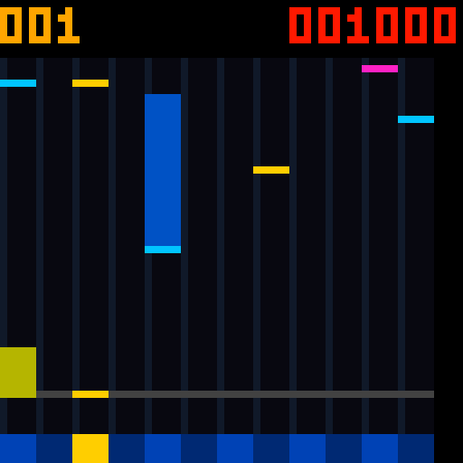

**得分显示修复（2026-10-28）：** PLAY/S1跟谱时没有数字的字库综合缺陷已修复；请使用[计分字库修复位流的交付报告](reports/score_visible_20261028/README.md)中记录的 `PCM5102_UNIFIED_SCORE_VISIBLE_FIX.fs`（位流本体按 `.gitignore` 留在本机），App Code46无需更新。[硬件复现与验证](reports/score_visible_20261028/README.md)。


**Code46 容量：每首最多256条事件，满分384000，连击/最高连击/Miss均支持256。** 最长曲目从[120首曲库](android_app/SONG_LIBRARY.md)列表选曲后自动载入，再匹配十二键下载；App Code47 起“载入长曲”快捷按钮已并入选曲流程，不再是单独入口。

# 十二键音游：五像素音符与四类玩法（Code46）

当前 App **1.46-cleanui / Code47**：[安装包](android_app/dist/FPGA-Music-Unified.apk)（滚动入口，内容即 `dist/FPGA-Music-CleanUI-Code47.apk`），超过128条需配套 Code46 之后的 FPGA 位流；Code47 只整理手机界面，音游协议与 FPGA 要求同 Code46。十二键音游设置、练习谱和读分位于 **曲谱** 页。

音游、下落指引与自动演奏**共用同一份板上已提交曲谱**。从[120首离线曲库](android_app/SONG_LIBRARY.md)选曲并下载成功后，PLAY 跟谱演奏并计分；自动演奏用于试听，不计分。手机保存整个曲库，FPGA只保存当前一首，增加手机曲目不增加FPGA资源。普通曲库曲目仍按时长自动判 TAP/HOLD；四类音符练习谱与类型CSV继续提供DRAG/FLICK。

屏幕左侧十二列从左到右对应 **K1～K12**，随自定义音高映射。底部只显示这十二键，音游页已移除 K13～K16 的四个提示格；这四键仍可正常演奏。右上红色六位得分横排显示，例如 `001000` 表示 **1000 分**；左上黄色三位为当前连击。十二列每列正好5像素，占用 x=0～59；右侧余下4列不显示额外键。

| 音符 | 颜色与操作 |
|---|---|
| TAP | 蓝色薄头，到灰色判定线时点击。即使时长超过500 ms，显式 TAP 仍是点按。 |
| HOLD | 蓝色头和较暗的蓝色尾条，到线时按住，尾条全部消失后松手。显式 HOLD 可短于500 ms。 |
| DRAG | 黄色，到线时接住；可以提前按住，无须每次重新点击。和弦需接住所有提示列。 |
| FLICK | 粉色两行阶梯，到线时从目标键滑向任意另一个触摸键，或按住目标键向任意方向挥手。复用原有 APDS-9960 手势传感器。 |

成功命中统一显示黄色反馈；HOLD 接住后，剩余尾条变黄，随滚动在判定线处逐段消失。Miss 为红色短闪。**TAP 为5像素宽、1像素高**；HOLD、DRAG 同样宽5像素；**FLICK 为5×2像素阶梯形**，上排右侧3点、下排左侧3点，下排到线时判定。下方十二个按键各宽5像素，按深浅蓝交替区分；命中亮黄。宽度固定，不再提供1/2像素选项。原主题和宽度协议字段为兼容保留，新App使用固定类型颜色与5像素宽度。

粉色轮廓与参考图相同（`#` 为粉色，`.` 为空）：

```text
..###
###..
```

TTP229 只提供离散键态，跨键滑动按“目标键已有接触，随后另一个键出现新接触”识别；同一采样中松开目标并接触新键也可命中，判定窗内也会保留已接住的目标键。它不能识别在同一触摸焊盘内部的方向移动。手势玩法须等 APDS-9960 初始化完成，在接触目标键后挥手；从未接触目标键的手势和上一条音符的手势不会累计到下一条。

## 开始

1. 使用 Code46 APK 和计分字库修复位流，连接 HC-05。接线沿用现有十六键串行配置及 APDS-9960。
2. 在曲谱页点“载入四类音符练习谱”，或导入自己的 CSV/MIDI。点击“校验键位并下载”，等待提交成功。
3. 在同页“十二键音游”卡片设定判定窗口、长按和闪光，再点“应用音游设置”。播放中不能改设置。
4. 点 PLAY 或按 S1，预备1.5秒后开始。S1/STOP 停止；S2在非XY页短按可从头重启。

普通 CSV/MIDI 仍兼容：时长 ≥500 ms 自动作为 HOLD，短音作为 TAP；关闭长按后 HOLD 按 TAP 处理。自动演奏 AUDITION 不计分。手机可手动读分或刷新，判定使用 FPGA 时钟，不使用蓝牙到达时间。

Perfect **1000** 分、Good **500** 分，HOLD 完成额外 **500** 分。Miss 清连击；提前松开长按、STOP 打断长按均没有完成分。四档窗口为 ±80/120/160/200 ms，Perfect 范围为一半；窗口在相邻事件边界截断。重新 PLAY 清空分数，结束后保留结果。

## 指定四类音符

最简三列表头：

```csv
pitches,duration_ms,note_type
60,400,TAP
62,1200,HOLD
REST,300,
64,150,DRAG
65,150,DRAG
67,150,DRAG
69,150,DRAG
71,600,FLICK
```

同时需要曲谱弯音时使用 `pitches,duration_ms,bend_target_cents,note_type`。类型可为 `AUTO`、`TAP`、`HOLD`、`DRAG`、`FLICK`，不区分大小写；空白为 AUTO。休止行类型留空或 AUTO。和弦各音共享类型、时长与弯音目标。导出当前曲谱会保留这些字段。

例谱：[rhythm_four_types.csv](android_app/examples/rhythm_four_types.csv)。显式类型下载前先用 `SONG_CHORD,?` 查询能力，新固件返回 `OK`；旧固件拒绝时，App 会在发送 `SONG_BEGIN` 前停止。旧 `SONG_BEGIN,?` / `SONGBEND,1` 弯音能力查询保持兼容。

下行仍用 `SONG_CHORD,index,mask,duration[,ratio]`，`mask` 低13位是 MIDI60～72 掩码，高3位是 AUTO=0 / TAP=1 / HOLD=2 / DRAG=3 / FLICK=4。曲谱 RAM 中把 AUTO 转换为实际二位类型；演奏、音高映射和弯音只读取原13位音高。非法类型、显式类型的休止和非法弯音比率会拒绝，保留旧有效曲谱。

显示以像素合并同列极密音符；实际判定仍逐事件进行。尾条复用同一滚动缓存，按事件持续时间持续输入蓝色身体像素，长于屏幕的部分从顶部进入，支持最长60000 ms事件；没有为每条长按增加独立计时器。



图为仿真，非实物照片。资源、时序、验证范围及回退见[本轮验收报告](reports/rhythm_width5_20261028/README.md)。
