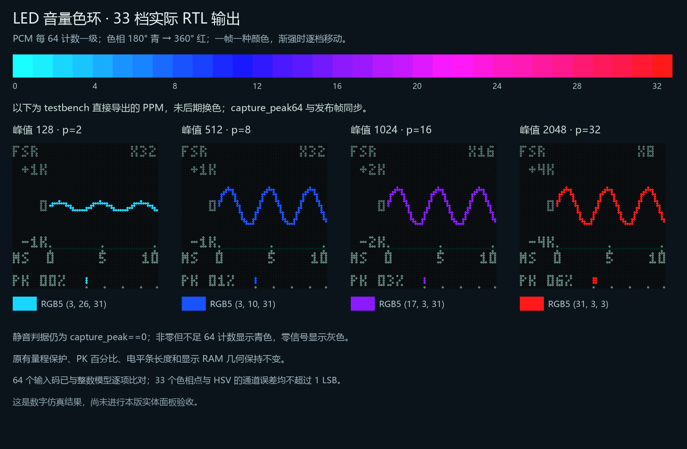

# LED 波形：FSR 量程与真实电平渐变

2026-10-23。波形页使用带时间刻度、正负幅度刻度的布局；本次仅把音量色环从 8 档改为 33 档。S2 长按、App 的 `VIS,1` 切页方式沿用原协议。



## 读图

- `FSR` 表示建议量程与实际 FSR 音量增益联动。正常演奏使用 `X8`、`X16`、`X32`；峰值较大时可自动退到 `X4`、`X2`、`X1`。
- 纵轴改为原始有符号 PCM 幅度，`K=1024` 个数字计数：±32K /16K /8K /4K /2K /1K 分别对应 X1 /2 /4 /8 /16 /32。零位在 y=27。满幅以 32768 为基准，不代表声压或实际压力。
- 横轴 `MS` 及 0、5、10 表示毫秒，完整窗口仍为 512 / 48828.125 ≈ 10.486ms。主图位于 x=16～63、y=8～45；时间刻度位于 x=16、39、62，按面板像素近似显示。
- 底部 `PK` 是当前显示窗口的最终混音绝对峰值百分比。峰值先向上量化到约 0.78% 满幅的幅度箱，再以箱中心换算并四舍五入为整数（误差不超过约 1 个百分点）；电平条始终为 0～100% 固定刻度，32 格、向上取整，零值不点亮。
- 静音才显示低亮白色。非零窗口峰值采用独立的 PCM/64 色相轴：每 64 个计数一级，0～2048 共 33 个色相点，180° 青 → 蓝 → 紫 → 品红 → 玫红 → 360° 红，每档 5.625°；2048 及以上钳为 `(31,3,3)`。RGB5 最低通道固定为 3、最高通道为 31，对应约 0.903 饱和度和满明度，不经过绿、黄或橙。2048 是音源 /16 衰减后的响度参考，不代表削波或声压。颜色与显示倍率无关。
- 一帧内波形及总电平条共用一种颜色，窗口在完整 PWM 帧边界同步发布；渐强或回落时颜色逐档移动，不是沿曲线位置着色。量程保护、PK 百分比和电平条长度继续使用原来的 `ceil(abs(PCM)/256)` 轴。非零但不足 64 个计数（包括 ±1）显示 `(3,31,31)`，只有原轴为零才显示灰色 `(8,8,8)`。

因此，FSR 使声音变小时，曲线可以保持相近高度，但纵轴范围会改变，PK 数值和固定电平条会变小，颜色也随真实峰值改变。

## FSR 量程规则

读取最终实际使用的 FSR 增益，事件回放时读取回放状态内的对应增益，不直接用原始 ADC 码。当前声音方向仍为轻压约 100%、重压约 25%；音高等旁路模式下，音量增益平滑回到满比例。

| 实际增益 | 建议显示倍率 | 纵轴范围 |
| --- | --- | --- |
| 大于 50% | ×8 | ±4K |
| 大于 25%、不超过 50% | ×16 | ±2K |
| 不超过约 25% | ×32 | ±1K |

回到较大量程时在 50% /25% 门限上方各加约 1.56 个百分点迟滞，避免边界反复跳档。倍率在下一次采集开始时锁定，波形、纵轴、颜色和 PK 在同一个完整 PWM 帧边界发布。

最终混音还包含不受 FSR 控制的音源和音效。当前窗口超出建议范围时，自动在六档中选择足够宽的范围。用保守峰值码判定范围，原始量化极值先保存，范围在发布时选择，不会先削平再改变刻度。

倍率上限为 ×32，基础倍率比上一版增加八倍。它仍不是将所有输入拉到相同高度的 AGC：同一 FSR 档位中，小信号仍比大信号矮，极弱信号仍受像素分辨率限制。音源、音色、包络、主音量和实际混音峰值不同，FSR 控制比例不等于 PK 百分比。

## 图形与扫描

48 个横向采集箱依次容纳 11、11、10 个样本，重复 16 次，共 512 个样本。每箱记录有符号 PCM 高 10 位的最小/最大值，并与上一箱最后一点衔接。量化步长从 256 降为 64 个计数，保留 X32 下每个可见像素所需的精度。六档纵向换算与原始 PCM 直接算术右移一致，显示量化不进入音频通路。

波形页底部改为总混音 PK 电平，三组触摸 /红外手势 /吉他幅度条继续保留在 XY 和 FFT 页，`VIZ?` 原有三组数据和包格式不变。REF /AUD 标签也复用新的字库。参考曲线、延时历史、FFT 数值和曲谱时序沿用原实现。

波形与 XY 共用 picture RAM（每字 20 位）；`scope_style.hex` 是原有 2048×16 只读表，六套静态刻度、字形和百分比换算的内容未改。扫描移位期间预取图形，行锁存高电平阶段复用读口做百分比换算，每行仍为 133 个主时钟。33 档色环采用限幅、移位、加减与取位，不新增 ROM 表项、BSRAM、DSP 或硬件乘除单元；音频通路没有新增处理级。

本图由 `tb_audio_scope` 合成 PCM 驱动 RTL 后逐像素导出，不是实板照片。实际面板色差、环境可见度与 FSR 实物响应仍需烧录后核对。构建资源、50MHz 时序和位流指纹以交付包及 [VERIFICATION.md](VERIFICATION.md) 本轮记录为准。

## 复现

```powershell
python tools/generate_scope_style.py --check
& ./tools/run_sim.ps1 -Tests tb_audio_scope
& ./tools/run_sim.ps1 -Tests tb_audio_visualizer
& ./tools/run_sim.ps1 -Tests tb_hub75e_audio_display
& ./tools/run_sim.ps1 -Tests tb_top_audio_visual
& ./tools/run_sim.ps1 -Tests tb_display_mode_control
python tools/check_scope_external.py
python tools/render_scope_hue_ramp.py
```

板上验收：按住同一音符并改变 FSR 压力，核对 X8 /X16 /X32 与纵轴、PK 和颜色；加入红外 /吉他音源检查范围保护；松键检查白色零线与 PK 归零，再切 XY /FFT 核对标签、音源条与声音连续。

本次修正针对实体照片中“X4、PK 约 2%、波形仍挤在零线且接近白色”的问题。先前 20% /40% /80% 的预览没有代表真实衰减后的音源。本版增加 128 /512 /1024 /2048 计数的弱信号夹具及真实触摸音源检查；图中的高幅示例是音量展示标尺，不是实际声压标定。
