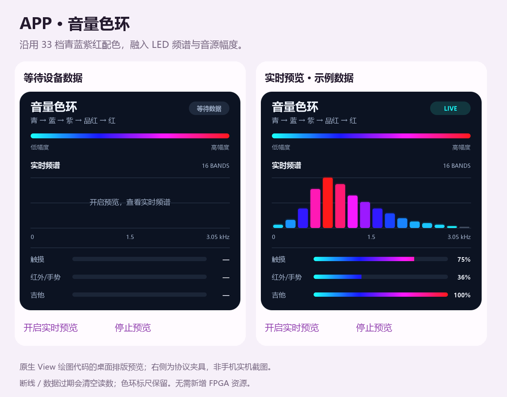

# App 音量色环 · Code25 / 1.24-hue

2026-10-23。将面板的 33 档青→蓝→紫→品红→红配色用于手机，在“显示”分区顶部提供深色仪表面板：连续色环标尺、16 段实时频谱和三组渐变幅度条。

[安装 Code25 APK](dist/FPGA-Music-Hue33-Code25.apk) · [滚动安装入口](dist/FPGA-Music-Unified.apk)

打开侧边栏 → 显示，即可看到色环面板。连接 HC-05 后点击“开启实时预览”，再演奏查看频谱和幅度变化；停止、断线或数据过期时清空读数，装饰性色环标尺保留。没有数据时不绘制模拟频谱。读屏描述包含三组实时幅度和频谱就绪状态。

手机和面板共用相同的 33 个 RGB5 色值锚点。手机标尺使用插值，电平条逐步揭示该渐变；频谱柱按本柱幅度选色。手机输入仍来自现有 `VIZ?`：频谱 0～31，触摸/红外手势/吉他幅度 0～56，各自按满刻度归一化。三组百分比表示各音源相对幅度，不是面板总混音 PK，也不是 PCM 峰值或声压。没有为手机传输新增板端 PCM/64 峰值。

本次只改 App；兼容原有支持 VIS/VIZ 的位流，不需要重新综合 FPGA，没有新增 FPGA 资源、命令或轮询请求。连接诊断、回复匹配与超时关闭连接逻辑沿用 Code24；最多每秒查询五次，其他命令和事件录制期间仍暂停预览。



上图执行实际 `SpectrumPreviewView` 绘图代码，经桌面 Canvas 适配器输出。右侧数据是协议夹具，图片不是手机实机截图；适配器只在 build 目录运行，不打包进 APK。

## 验证

- `test-core.ps1` 全套通过，包括 SppLink 255 项及既有 LED/UART、录制、曲库和演奏控制回归。
- 新增 LedHue 431 项检查：33 个锚点/HSV 单通道误差≤1LSB、饱和与零幅度、手机两种归一化刻度；读取本轮 RTL CSV，64 个调色输入码全部一致。
- 桌面原生绘图代码排版检查：240/252/280/320/360/412dp 六种宽度、等待/实时/零幅度/FFT未就绪/满幅/数据过期六种状态，共36张图，无绘图或文字越界；数据过期与初始空白画面逐字节一致。
- Java/D8 编译、APK 对齐、v3 签名及 Manifest 版本核对通过。版本 Code25 /1.24-hue，包名 `cn.fpga.score`，使用原调试签名，可覆盖同签名旧版；未安装或连接实体手机验证。

构建记录、SHA256 与原始日志见 [本轮交付](../deliveries/APP_HUE33_20261023/README.md)。

```powershell
.\test-core.ps1
python design/render_hue_preview.py
.\build-apk.ps1 -OutputApk 'dist\FPGA-Music-Hue33-Code25.apk'
```
