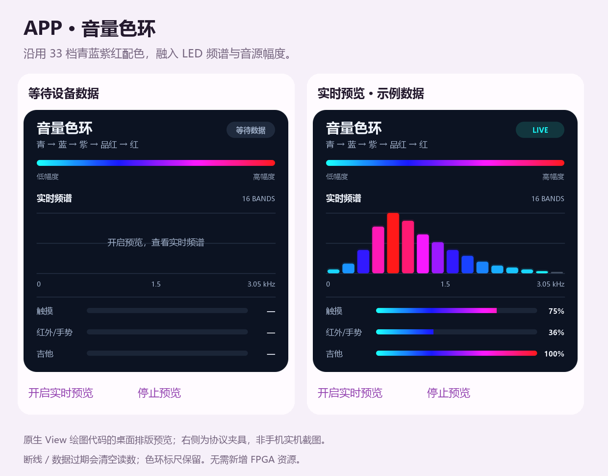

# App 色环交付 · Code25 / 1.24-hue

2026-10-23。将青→蓝→紫→品红→红的33档配色融入 App：显示分区顶部的深色频谱、连续色环标尺、三组渐变幅度条与百分比。等待/停止/断线/过期时不保留旧读数。本轮只改App，95份板端RTL/ROM/约束/工程输入与前一轮33档冻结构建一致，无新增FPGA资源，也不需要为该App界面重新烧录。

[安装 APK](FPGA-Music-Hue33-Code25.apk) · [界面效果](app_hue33_preview.png) · [App 源码差异](source_diff.patch)

在侧边栏选择“显示”；连接HC-05后点击“开启实时预览”。色值锚点与RTL相同；手机按现有频谱0～31、三音源幅度0～56分别归一化，百分比是音源相对幅度，不冒充面板混音PK。没有改变协议或轮询频率。

APK包名 cn.fpga.score，Code25 /1.24-hue；原签名证书与Code24一致，支持覆盖同签名版本。Java/D8、对齐、v3验签、Manifest核对均通过。独立APK与默认dist/FPGA-Music-Unified.apk相同；旧默认APK备份在 android_app/build/hue_ui_before_20261023/，Code24独立安装包保留。未安装实体手机；图片执行原生View绘图代码经桌面Canvas适配器生成，右侧为协议夹具，非实机截图。

SHA256 `70059516F69EB2DBF792F22A973A13CF6257EA006D5AE8C9BFF961528D833B2F`

## 改动行号

- `app/build.gradle`: 5
- `app/src/main/AndroidManifest.xml`: 2
- `app/src/main/java/cn/fpga/score/LedHue.java`: 1-30
- `app/src/main/java/cn/fpga/score/MainActivity.java`: 508-509, 538-543, 548
- `app/src/main/java/cn/fpga/score/SpectrumPreviewView.java`: 5, 7-8, 11, 13, 15-16, 18-30, 32-82, 84-85, 87-90, 92-93, 95-107
- `core_test/LedHueTest.java`: 1-46
- `design/render_hue_preview.py`: 1-131
- `HUE33.md`: 1-30
- `README.md`: 3-5
- `test-core.ps1`: 5-10

另更新工程 README / VERIFICATION 的安装入口和验证记录。完整App改动片段、前后源文件和原始日志均随包提供。

## 验证原文

```text
PASS RTL RGB5 palette -> App: all 64 hardware codes match
PASS LedHue: 431 checks, 33 anchors/HSV, silence, saturation and independent App scales
PASS PerformanceParams: 8690 checks; unit conversions, quantized round trips, firmware bounds, query parsing, Chinese errors
PASS LedProtocol: 180 checks
PASS RTL UART -> Java LED state/spectrum: atomic live and reset snapshots
PASS top live C4 -> UART -> Java spectrum: frequency band and frame metadata
PASS LedProtocol: 203 checks
PASS TakeStatusTest: 17 checks
PASS RecordingSupport: 17 checks; event-only queries and rejection recovery
PASS PhoneTake: 10054 checks; local note timing/hold/velocity, standard MIDI, 25 independent saves/reopen/rename/delete, CRC, failure preservation, 10000-note bound and long silence
PASS SongLibrary: 4128 assertions
PASS ControlState: 33 checks
PASS TakeWorkflow: 285 checks
PASS SppAudio: 15 checks; removed PCM commands never reach Bluetooth
PASS ChromaticKeys: 77 checks; scan/pitch geometry and all sixteen MIDI notes
PASS device controls: 4695 assertions
PASS VoiceBend: 7229 assertions; all cents, protocol, pitch error, coalescing/fairness/offline/last edit/batch isolation
PASS AdsrProfile: 5032 assertions
PASS SongCodec: 31 assertions
PASS SppLink: 255 assertions
PASS AudioRecording: 1203 checks
PASS RTL UART -> Java receiver -> WAV: 1501 samples preserved bit for bit
PASS AudioRecording: 11 checks
PASS top I2S -> 2Mbps UART -> Java receiver -> WAV: 712 samples bit-exact
PASS AudioRecording: 11 checks
PASS native View desktop layout: 36 captures, 240/252/280/320/360/412dp, waiting/live/zero/loading/full/stale; no drawing or text overflow
OK App hue preview and stale-state equality -> E:\130_FPGA_Verilog\TP-25K\pmod_hub75e_TTP229\pcm5102_pam8403\android_app\design\out\hue33\app_hue33_preview.png
PASS APK signing certificate matches previous Code24 APK
```


