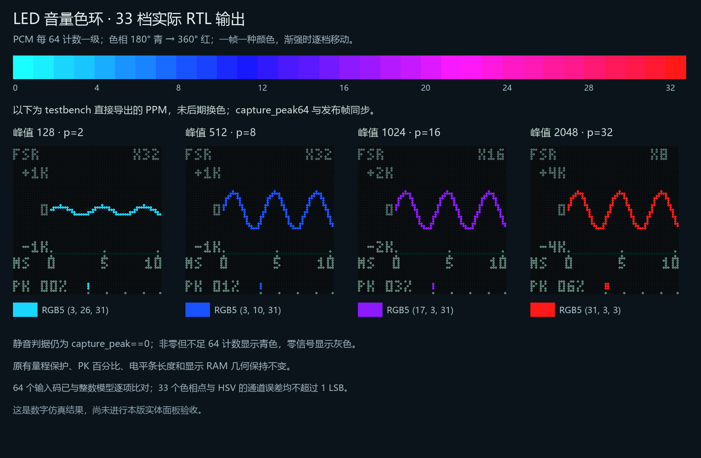

# LED 音量 33 档色环交付（2026-10-23）

把当前 8 档升级为 33 档整帧色相；每 64 PCM 计数一级，2048 及以上钳红。按用户确认的验收口径，先取原始 PCM 绝对值再除以 64：±1 青色，只有真正的零信号显示灰色。保持原有量程保护、PK、条长、10 位波形步长、20 位显示 RAM 和 ROM 内容。

[已验证位流](PCM5102_UNIFIED.fs) · [实际 RTL PPM 对照图](hue33_verified.png) · [完整 diff](source_diff.patch) · [资源 JSON](evidence/resources_comparison.json)

## ① 全部改动行号

以执行本任务前的用户 8 档工作区为基线；不是与较早 Git HEAD 比较。删除点指新文件中的相邻行。

- `AUDIO_VISUAL.md`：23
- `impl/PCM5102_UNIFIED_process_config.json`：60
- `README.md`：2–3
- `SCOPE_DISPLAY.md`：3；5；13–14；40；48–52；54
- `sim/tb_audio_scope.v`：9–12；19–22；26–29；60–62；90–116；120–123；135；140；144；146；166；174–206；209
- `sim/tb_audio_visualizer.v`：核对无须修改，现有断言继续通过。
- `sim/tb_hub75e_audio_display.v`：核对无须修改，现有断言继续通过。
- `sim/tb_top_audio_visual.v`：核对无须修改，现有断言继续通过。
- `src/audio_scope.v`：8；37–42；44–45；48–57；59；70–72
- `src/audio_visualizer.v`：43–49；123；139；160；188
- `tools/build_unified.tcl`：13
- `tools/check_scope_external.py`：10
- `tools/render_scope_hue_ramp.py`：1；4；10–14；17–22；26–45；47；49–82；85；87
- `VERIFICATION.md`：2–11

具体片段见完整 diff；基线/结果文件分别冻结于 source_before/source_after。为满足时序调整的构建参数 diff 也包含在内。完整构建输入按 sources.json 冻结于 frozen_inputs/。

## ② 验证原文

依次执行 tools/run_sim.ps1 -Tests 单个名称：tb_audio_scope → tb_audio_visualizer → tb_hub75e_audio_display → tb_top_audio_visual → tb_display_mode_control；没有使用 Quick。顶层完整仿真到 196.117712ms，含六种 XY 预设及八幅整屏导出。随后执行外部模型和 renderer。原始日志在 logs/。

```text
PASS scope hue33: 65536 signed magnitudes, 2016 coordinates, 387 range selections, 64 monotonic saturated palette codes, +/-1 cyan/zero gray, 33 rising/falling window snapshots, no stale peak, six RTL PPM exports
PASS audio visualizer: 65536 signed PCM coordinates, 48-bin whole-window extrema/buffering, signed peaks/decay, delayed-audio XY bitmap, real FFT bars/gaps/noise floor and pixel colors
PASS HUB audio display: external wave/XY pixels, FFT startup blanking, RAM prefetch, three group bars, unchanged 133-clock scan, whole-PWM four-mode switch, hidden guide descent
PASS top audio visual: exact I2S tap/continuous phase, live touch/IR/guitar, C4 FFT, S2 modes and six XY presets, UART XY while playing, score uninterrupted, external I2S/HUB and eight panel captures
PASS top dashboard: UART volume/effect/hold/timbre/pressure/analog, real ADC conversion, physical touch/IR, automatic idle status and external RGB5 frame
PASS top remote visual: four UART pages, whole-frame activation, atomic 32-byte live C4 preview, uninterrupted score/I2S/phase
PASS display mode: short release, threshold, one action/hold, long release suppression, guide/wave/XY/spectrum cycle, reset
PASS external scope: 4096 pixels / 12288 RGB5 channels, all 32 PWM phases, static axes/header, dynamic PK digits, first/last capture columns and fixed meter
OK 64 RTL palette codes, 33 unique hues, HSV error <=1 LSB, monotonic saturation, 4 real RTL frames -> E:\130_FPGA_Verilog\TP-25K\pmod_hub75e_TTP229\pcm5102_pam8403\design\led_scope_20261023\hue33\hue33_verified.png
```

## ③ 整机资源与 50MHz 时序

8 档基线也重新完整综合/PnR。基线 `scope_hue8_baseline_20261023`；本次 `scope_hue33_20261023_p3r0`。

| 项目 | 8 档基线 | 33 档交付 | 变化 |
|---|---:|---:|---:|
| Logic | 21590 | 21503 | -87 |
| CLS | 11080 | 11202 | +122 |
| Register | 10321 | 10326 | +5 |
| BSRAM | 47 | 47 | +0 |
| DSP | 26.5 | 26.5 | +0 |
| WNS_ns | 0.233 | 0.198 | -0.035 |

最终 Fmax 50.499MHz；Setup/Hold 违例均为 0，95 份 RTL/ROM/约束/工程输入与当前工作区一致。新增色相计算仅限幅、移位、加减和取位，无新 BSRAM、ROM 表项、DSP 或硬件乘除单元。Logic/CLS 是整机布局结果，变化也受布局策略影响，不等于颜色电路的独立面积。

硬件容量与时序通过；后续功能规划的 Logic 预留仍差 113，CLS 预留差 47，没有把该预留审计记为通过。当前剩余 Logic 1537 / CLS 318 / BSRAM 9。

初次默认策略（place2/route0）WNS=-2.091ns，另试 place2/route2 留下141条未布通网络，均未作为交付。最终使用 place3/route0/maxfan23；三者 RTL/ROM 输入相同，未改音频逻辑来修时序。失败实验的日志也保留在 logs/。

UserCode `0x00002176`；位流 SHA256 `A5567DB120334D16B9B72071E0F0D2754B64E1AFE44878D22ED1243700A52B35`。默认 impl/pnr 与交付位流指纹一致，配套综合/PnR输出也已同步；旧默认与配置备份保存在 sim/build/pre_hue33_default_20261023/。本次未烧录，也未做本版实体面板验收。

## ④ 上板应看到

缓慢渐强时，整条波形和电平条逐档滑过青→蓝→紫→品红→红；松手回落时倒着滑回青、不卡红，零信号才变灰。


