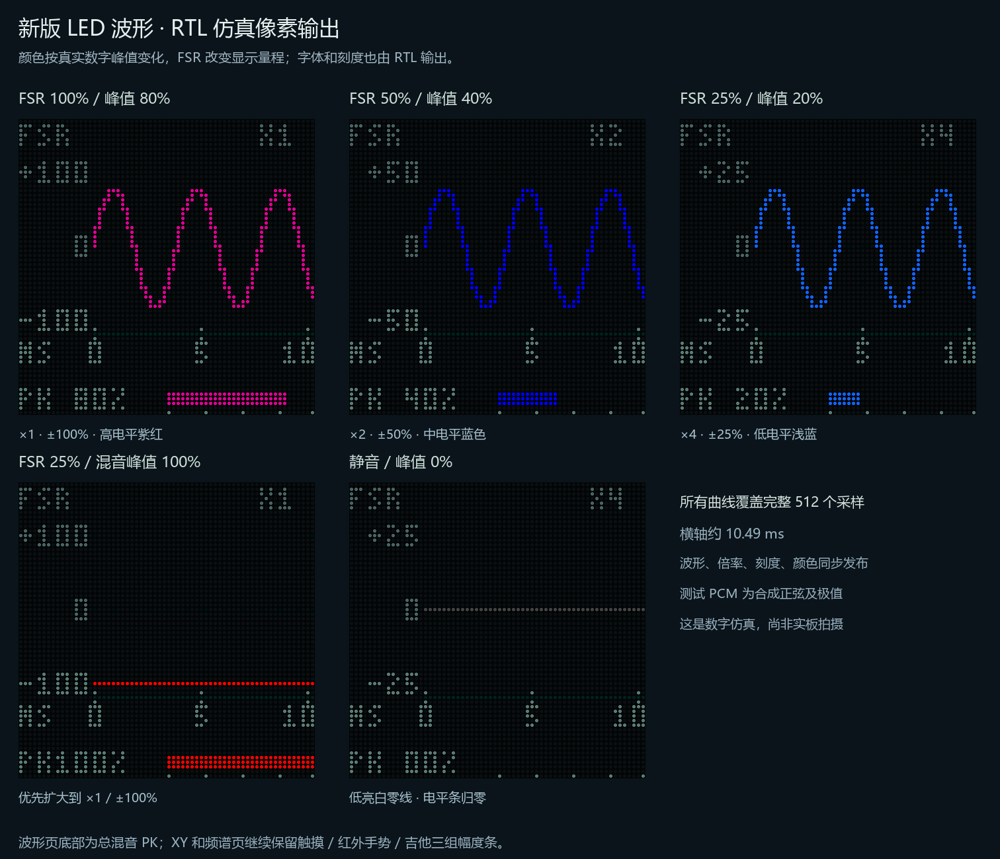

# LED 波形、FSR 量程与真实电平渐变

2026-10-22。主工程 `PCM5102_UNIFIED.gprj` / `top_unified`，保留四档回声、现有演奏参数和事件录制配置，仅更新显示链路。

**烧录文件：[PCM5102_UNIFIED.fs](PCM5102_UNIFIED.fs)**。UserCode **0x00006DCF**。尚未烧录开发板，现有 App 协议保持兼容，无需为本次显示更新更换 APK。



## 显示行为

- 波形页有时间刻度和纵向数字幅度刻度，48 列完整覆盖 512 个采样、约 10.486ms；波形与相邻采集箱衔接。
- FSR 实际音量增益提供 X1 /X2 /X4 建议倍率，纵轴为数字满幅 ±100% /±50% /±25%，有迟滞。最终混音超出建议范围时扩大范围，刻度和波形同时发布。
- 颜色按真实窗口峰值分为 16 个非零等级，由白蓝、浅蓝、蓝、紫逐级到红；静音显示低亮白零线。它不跟随显示倍率补偿。
- PK 数字和电平条保持 0～100% 固定满幅刻度，用于区分真实强弱。波形页使用总电平，三音源条继续保留在 XY /FFT 页及 VIZ 快照中。

FSR 方向仍为轻压大声、重压小声；音高模式旁路音量表达。显示倍率最高 X4，没有信号跟随 AGC，极弱信号仍可能很小。PK 是数字幅度，不是声压或人耳响度。详细量化、范围保护与操作见 [SCOPE_DISPLAY.md](SCOPE_DISPLAY.md)。

## 整机资源与时序

比较基线是四档回声优先版，以下均为完整整机 PnR 数据，不能将增量全部归因于渐变颜色。

| 项目 | 基线 | 本版 | 增量 |
| --- | ---: | ---: | ---: |
| Logic | 21088 | 21387 | +299 |
| CLS | 11060 | 11145 | +85 |
| Register | 10239 | 10306 | +67 |
| BSRAM | 44 | 45 | +1 |
| DSP | 26.5 | 26.5 | 0 |

新增 BSRAM 用于共用静态布局、字形与百分比表；渐变色使用组合逻辑。剩余 **1653 Logic /375 CLS /11 BSRAM**，仍覆盖 D、B2、E100 和安全垫的 **1650 Logic /365 CLS /4 BSRAM** 预留。超出上述预留的空间只剩 **3 Logic /10 CLS /7 BSRAM**，后续新增功能需重新核算。

50MHz 约束，Fmax **50.438MHz**，Setup /Hold 违规端点均 **0**，没有未布通网络。冻结构建 `scope_fsr_gradient_v5_20261022` 的 95 份 RTL /ROM /约束 /工程输入与当前工作区逐项匹配，审计见 [scope_release_audit.json](reports/scope_release_audit.json)。

## 验证范围

最终版本通过 11 个相关 RTL 测试，日志位于 `tests/`：

- 65536 个 PCM 值的保守峰值量化、768 个有符号坐标映射、48 箱完整 512 采样、前后缓冲、FSR 三档与迟滞、同 PCM 在不同倍率下颜色 /PK 不变、混音超范围扩大、静音归零。
- XY 的 12 组频率比 /相位、3072 个参考点、32 采样延时、REF 标签；实际 FFT 柱与源幅度条；曲谱逐行 /逐引脚对照。
- HUB75 外部扫描 /锁存 /行序和每行 133 主时钟保持；独立光栅模型逐项核对完整 32 PWM 相位重建的 **4096 像素 /12288 个 RGB5 通道**，覆盖静态轴线、字形、动态 PK、首尾列和电平条。
- FSR 模块全码与真实时序 ADC 行为模型，板级 S2 长短按与蓝牙切页 /查询。
- 最终顶层 Quick 运行 **87.164ms**，保留实际 50MHz /1024 音频节奏，检查触摸 /红外 /吉他、I²S 连续、真实 C4 FFT、曲谱不停、UART 切页 /快照及总览。Quick 只省略六个 XY 预设的整屏抓图；几何和切换另由模块测试覆盖，不能把该次 Quick 记为六预设全量顶层抓图。其日志中的通用 PASS 文案仍沿用旧文本；源码已修正未来输出。

优化前的一次完整 196.118ms、八画面顶层联动也通过，仅作为历史补充保留在 `tests/top_intermediate_full.log`，不代替最终 Quick 和模块 /引脚验证。`preview/top_*.png` 为最终顶层 Quick 从外部 HUB 信号重建的演奏画面，其他五张对比图为最终独立模块的合成 PCM 夹具。

这些是数字仿真与静态时序结果，尚未进行本版 FSR、实体 LED 颜色、摄像效果和模拟声音上板验收。没有写入 FPGA SRAM /Flash，也没有安装手机 APK。

## 文件指纹与复现

位流 SHA256：

```text
2A1BCDE333A880DD7ED8743B2ADDEAEC314638D38511AB568A83558713EB09A0
```

全部交付文件的校验见 `SHA256.json`。资源及完整时序 HTML 位于 `reports/pnr/`，输入清单为 `reports/sources.json`。源码在仓库主工程中，本包不是独立源码工程。

在主工程目录复现：

```powershell
python tools/generate_scope_style.py --check
& ./tools/run_sim.ps1 -Tests tb_audio_scope,tb_audio_visualizer,tb_lissajous_delay,tb_lissajous_reference,tb_hub75e_audio_display
python tools/check_scope_external.py
& ./tools/run_sim.ps1 -Quick -Tests tb_top_audio_visual
& ./tools/check_unified_build.ps1 -Label my_scope_rebuild
python tools/check_scope_release.py my_scope_rebuild
```

重新综合 /布局布线可能得到不同字节或资源打包，必须重新通过审计；不能仅靠 UserCode 相同认定与本包字节相同。
