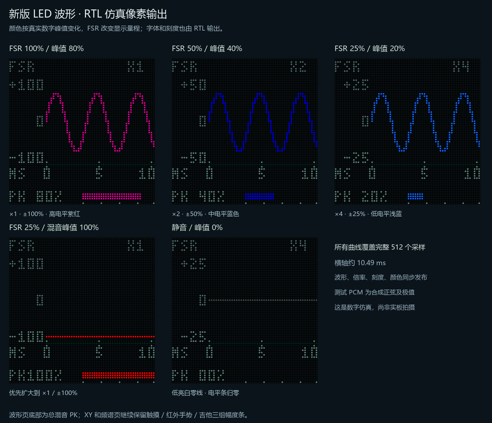

# LED 波形：FSR 量程与真实电平渐变

2026-10-22。波形页使用带时间刻度、正负幅度刻度的布局。S2 长按、App 的 `VIS,1` 切页方式沿用原协议。



## 读图

- `FSR` 表示该页的建议量程与实际 FSR 音量增益联动；右上角 `X1`、`X2`、`X4` 是最终采用的显示倍率。顶部没有另放一组 FSR 百分比数字，以减少重复换算和拥挤。
- 纵轴 ±100 / ±50 / ±25 的单位是数字满幅百分比，零位在 y=27。满幅以 32768 为归一化基准，不代表扬声器响度、声压或实际压力。
- 横轴 `MS` 及 0、5、10 表示毫秒，完整窗口仍为 512 / 48828.125 ≈ 10.486ms。主图位于 x=16～63、y=8～45；时间刻度位于 x=16、39、62，按面板像素近似显示。
- 底部 `PK` 是当前显示窗口的最终混音绝对峰值百分比。峰值先向上量化到约 0.78% 满幅的幅度箱，再以箱中心换算并四舍五入为整数（误差不超过约 1 个百分点）；电平条始终为 0～100% 固定刻度，32 格、向上取整，零值不点亮。
- 波形颜色也由同一窗口的真实峰值决定：静音低亮白，非零信号从白蓝、浅蓝、蓝逐级过渡到紫、紫红、红。共有 16 个非零颜色等级，红端约从 93% 满幅开始，静音另用 RGB5=(8,8,8)。颜色不随显示倍率补偿。

因此，FSR 使声音变小时，曲线可以保持相近高度，但纵轴范围会改变，PK 数值和固定电平条会变小，颜色也随真实峰值改变。

## FSR 量程规则

读取最终实际使用的 FSR 增益，事件回放时读取回放状态内的对应增益，不直接用原始 ADC 码。当前声音方向仍为轻压约 100%、重压约 25%；音高等旁路模式下，音量增益平滑回到满比例。

| 实际增益 | 建议显示倍率 | 纵轴范围 |
| --- | --- | --- |
| 大于 50% | ×1 | ±100% |
| 大于 25%、不超过 50% | ×2 | ±50% |
| 不超过约 25% | ×4 | ±25% |

回到较大量程时在 50% /25% 门限上方各加约 1.56 个百分点迟滞，避免边界反复跳档。倍率在下一次采集开始时锁定，波形、纵轴、颜色和 PK 在同一个完整 PWM 帧边界发布。

最终混音还包含不受 FSR 控制的音源和音效。若当前窗口真实峰值超过 25% 或 50%，实际显示范围会扩大到能够容纳该窗口的 ±50% 或 ±100%。原始量化极值先保存，范围在发布时选择，因此不会把已经截断的窄量程波形冒充为完整数据。

倍率上限为 ×4；FSR 满音量时极弱信号仍可能只有少量像素。本版没有增加跟随信号幅度的 AGC、手动缩放命令或新的触摸单源页面。音源、音色、包络、主音量和实际混音峰值不同，FSR 控制比例不等于输出的 PK 百分比。

## 图形与扫描

48 个横向采集箱依次容纳 11、11、10 个样本，重复 16 次，共 512 个样本，不裁掉时间窗口。每箱记录有符号 PCM 高 8 位的最小/最大值，并与上一箱最后一点衔接。三档纵向换算与原始 PCM 直接算术右移一致；显示极值的量化不进入音频通路。

波形页底部改为总混音 PK 电平，三组触摸 /红外手势 /吉他幅度条继续保留在 XY 和 FFT 页，`VIZ?` 原有三组数据和包格式不变。REF /AUD 标签也复用新的字库。参考曲线、延时历史、FFT 数值和曲谱时序沿用原实现。

波形与 XY 继续共用原 picture BSRAM；`scope_style.hex` 是一块 1024×16 只读表，保存三套静态刻度、字形和百分比换算常量。扫描移位期间预取图形，行锁存高电平阶段复用读口做百分比换算，并在随后的发布边沿直接锁存结果，外部每行仍为 133 个主时钟。颜色表使用小规模组合逻辑，声音通路没有新增处理级。

本图由 `tb_audio_scope` 合成 PCM 驱动 RTL 后逐像素导出，不是实板照片。实际面板色差、环境可见度与 FSR 实物响应仍需烧录后核对。构建资源、50MHz 时序和位流指纹以交付包及 [交付验证](README.md) 本轮记录为准。

## 复现

```powershell
python tools/generate_scope_style.py --check
& ./tools/run_sim.ps1 -Tests tb_audio_scope,tb_audio_visualizer,tb_lissajous_delay,tb_lissajous_reference,tb_hub75e_audio_display
python tools/check_scope_external.py
python tools/render_scope_verification.py
& ./tools/run_sim.ps1 -Quick -Tests tb_top_audio_visual
& ./tools/run_sim.ps1 -Tests tb_fsr_pipeline,tb_display_mode_control,tb_hc05_visual
```

板上验收：进入波形页，按下音符并改变 FSR 压力，核对 X1 /X2 /X4 与纵轴；比较 PK 和波形颜色；加入红外 /吉他音源检查范围保护；松键静音后检查白色零线与 PK 归零，再切 XY /FFT 核对标签、音源条与持续声音。
