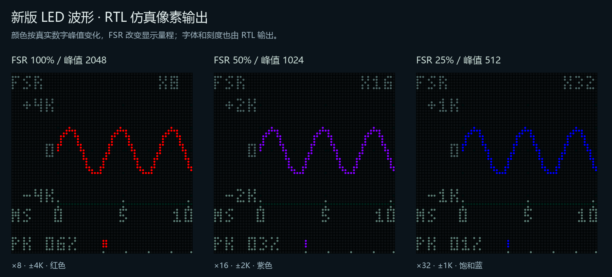

# LED 弱信号与颜色标定修正版

针对实体照片中“X4、PK 约 2%、波形仍很小且近白色”的修正。旧版按数字满幅设置阈值，且仅用 20% /40% /80% 的大信号预览，没有代表工程 /16 衰减后的正常音源。

**本次使用 [PCM5102_UNIFIED.fs](PCM5102_UNIFIED.fs)**，UserCode **0x00007D67**。旧 `LED_SCOPE_20261022` 包保留为历史，不是本次位流。没有烧录 FPGA 或更换 APK。



## 改动

- 基础倍率提高八倍，FSR 建议 X8 /X16 /X32；纵轴 ±4K /2K /1K，K=1024 个原始 PCM 计数。较大的信号自动扩大至 X4 /X2 /X1，保护完整波形。
- 采集极值保留有符号 10 位，量化步长从 256 降为 64，保留 X32 下每个可见像素所需精度。没有改变音频样本、音量或 FSR 方向。
- 静音才为低亮白。非零峰值用饱和蓝、紫、红，不再使用近白的浅蓝。红端按衰减后的演奏电平标定，约从原始峰值 1793 起，不代表数字削波或声压；颜色与显示倍率无关，PK 保留数字满幅百分比。
- 为保持资源预算，`hc05_keymap`、`take_nor_store` 只增加 onehot 综合编码属性；状态逻辑、协议和存储分区不变。

详细标尺、迟滞、范围保护与操作见 [SCOPE_DISPLAY.md](SCOPE_DISPLAY.md)。最大倍率仍为 X32，极弱信号受像素分辨率限制，不是将任意输入拉到满屏的 AGC。

## 完整构建

冻结构建 `scope_weak_signal_v11_20261022`；95 份 RTL /ROM /工程 /约束输入与工作区逐项匹配。

| 项目 | 上一版 | 本版 | 差值 |
| --- | ---: | ---: | ---: |
| Logic | 21387 | 21394 | +7 |
| Register | 10306 | 10306 | +0 |
| CLS | 11145 | 11087 | -58 |
| BSRAM | 45 | 47 | +2 |
| DSP | 26.5 | 26.5 | +0 |

50MHz 约束，Fmax **51.441MHz**，Setup /Hold 违规均 **0**，无未布通网络。剩余 **1646 Logic /433 CLS /9 BSRAM**。原后续规划要求 1650 Logic /365 CLS /4 BSRAM；本版 Logic 余量少 4 个，CLS 和 BSRAM 满足。严格的后续预留审计未通过，硬件容量、50MHz 时序和源码一致性检查通过；后续功能实施前需回收这 4 个 Logic。 资源、时序和源文件指纹见 [scope_release_audit.json](reports/scope_release_audit.json)，其中 `future_reserve_passed=false` 保留这一事实。

## 验证范围

15 个相关测试通过，完整日志与 PASS 清单位于 `tests/`：

- 65536 个 PCM 的保守峰值量化、2016 个有效有符号坐标、387 个峰值 /FSR 档位组合；真实幅度 128 /512 /1024 /2048 的波形与非白色、六档范围保护、512 个采样 /48 箱、静音、迟滞和同步发布。
- 独立模型逐项核对外部 HUB75 重建的 4096 像素 /12288 RGB5 通道，覆盖所有 32 个 PWM 相位。外部扫描仍为每行 133 个时钟。
- 真实顶层 Quick 运行 87.164ms，使用 50MHz /1024 音频节奏；真实触摸、IR、吉他、ADC、UART 切页、I2S 连续和曲谱运行通过。Quick 不重新导出全部六种 XY 预设整屏图，几何与全部预设由模块测试覆盖。
- 512 次 UART 差分事务、81 个演奏参数回复、事件录制和 NOR 行为模型、录制原子性回归通过。NOR 模型测试不等于实体 Flash 上板验收。

预览中的 `scope_*` 是合成 PCM 驱动 RTL 的像素；`real_*` 是真实音源链路仿真，由外部 HUB75 引脚重建。尚未进行此版实体面板与摄像效果验收。

## 文件与复现

位流 SHA256：`C54EF13D2975A7C1BF646A314F207C9D68202129A8D206CC362255D9EFD08B6A`。文件清单见 `SHA256.json`。标准 `impl/pnr/PCM5102_UNIFIED.fs` 已同步这一份；上一份默认产物保存在 `sim/build/pre_weak_fix_default_20261022/`。

```powershell
python tools/generate_scope_style.py --check
& ./tools/run_sim.ps1 -Tests tb_audio_scope,tb_audio_visualizer,tb_hub75e_audio_display
python tools/check_scope_external.py
& ./tools/run_sim.ps1 -Quick -Tests tb_top_audio_visual
& ./tools/check_unified_build.ps1 -Label my_scope_weak_rebuild
python tools/check_scope_release.py my_scope_weak_rebuild --report-reserve-shortfall
```

工程已经包含 `audio_scope.v`。若 IDE 仍显示 unknown module，请重新打开主 `PCM5102_UNIFIED.gprj`，使文件列表与磁盘同步。
