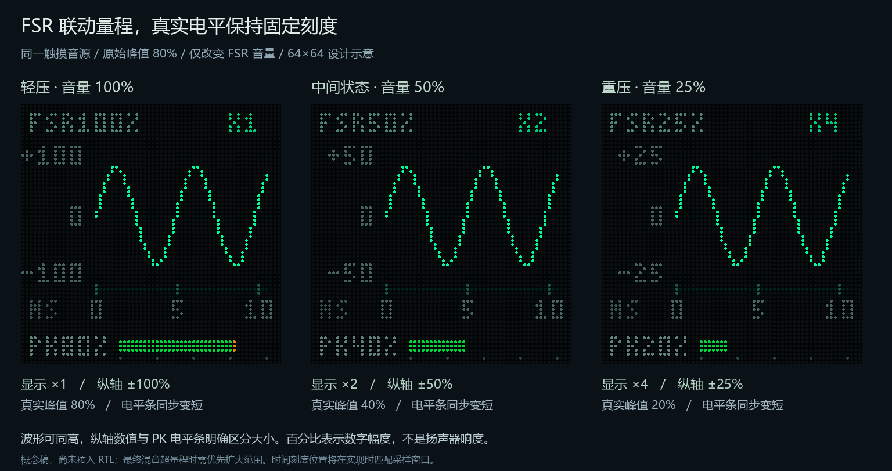

# FSR 联动显示量程草案

2026-10-22。依用户建议，先确定音量、倍率和真实幅度之间的刻度关系。仍为外观与交互设计，不修改生产 RTL、声音增益方向或标准位流。

## 三个量分别表示什么

- `FSR100%`：FSR 实际施加的音量增益比例，100% 表示不衰减，50% 表示振幅乘 0.5。它不是总混音的真实幅度。
- `X1/X2/X4`：相对于纵轴 ±100% 数字满幅的显示放大倍率，完全不进入声音通路。
- `PK80%`：观察窗口内最终混音的绝对峰值，按 `max(abs(PCM))/32768 × 100%` 归一化。底部固定刻度条始终为 0～100%，不跟随倍率变化。

百分比不代表声压、功放电位器位置、人体感知响度或牛顿等压力单位。FSR100% 时没有按键发声，PK 仍应为 0%。

## 联动方向

当前 `top.v` 配置默认 `FSR_GAIN_REVERSE=1`，FSR 音量表达的实际增益约为轻压 100%、重压 25%。音高模式或其他模拟控制模式下，FSR 音量表达被旁路并回到满比例。

联动使用平滑后的、实际施加的音量增益，不能直接使用 ADC 原始压力码。事件回放若需要显示这项控制，必须跟随回放时实际使用的增益，而非现场传感器。

| FSR 实际增益示例 | 显示倍率 | 纵轴正负边界 | 示例原始峰值 80% 经 FSR 后 |
| --- | --- | --- | --- |
| 100% | ×1 | ±100% | 80% |
| 50% | ×2 | ±50% | 40% |
| 25% | ×4 | ±25% | 20% |

图中三条波形同高是联动缩放的结果，不表示三段音频同样大；纵轴与 PK 固定电平条共同表达真实大小。中间音量采用有限档位，具体切换门限和迟滞待实施时确定，避免 ADC 抖动导致跳档。不要把三张图误读为 FSR 本身只有三档音量。

## 总混音的范围保护

FSR 目前只控制触摸音量，最终混音还包含红外/手势、吉他、音效和主音量处理，因此 FSR 只提供建议量程，不能保证总信号一定落在该范围内。

- 触摸音源单独观察时，可直接采用联动量程。
- 最终混音观察时，真实峰值越过建议范围必须优先扩大范围，例如由 ±25% 退到 ±50% 或 ±100%；纵轴和倍率标识同步更新。
- 复音、音效或其他音源使峰值变大时，不能仍将高波形显示为 ±25% 内的信号。
- 音量增大时先扩大范围，缩小范围则需要稳定保持；具体检测延迟、门限、窗口长度与资源费用在 RTL 实施时验证。
- 倍率、刻度与波形缓冲在同一个完整显示帧边界一起发布；旧曲线不能配上新刻度。采集中途若改档，应从头重采，或推迟到下一完整采集窗口。
- FSR 没有处于有效音量控制模式时，建议量程回到 ±100%；输入变化仍由真实数字电平表达。

横轴继续表示采样时间，FSR 不改变横向时间范围和声音采样率。实现时应按真实 512 采样 / 48828.125Hz 窗口约 10.486ms 安排 0、5、10ms 刻度；当前图片仅用于审美比较。

## 实施前尚待验证

纵向刻度占用左侧像素后，主图横向可用宽度下降。需要决定如何把 64 列采样范围映射到约 43 列图形区域，并保留峰值；不能直接裁去最后 21 列再沿用旧时间标签。也需检查整机资源与时序，再决定是否增加独立触摸观察选项。本稿不承诺新页面或新增控制命令。

复现：`python tools/render_scope_fsr_concept.py`。图中正弦为人工构图数据，不是现场测量或 HDL 仿真结果。
