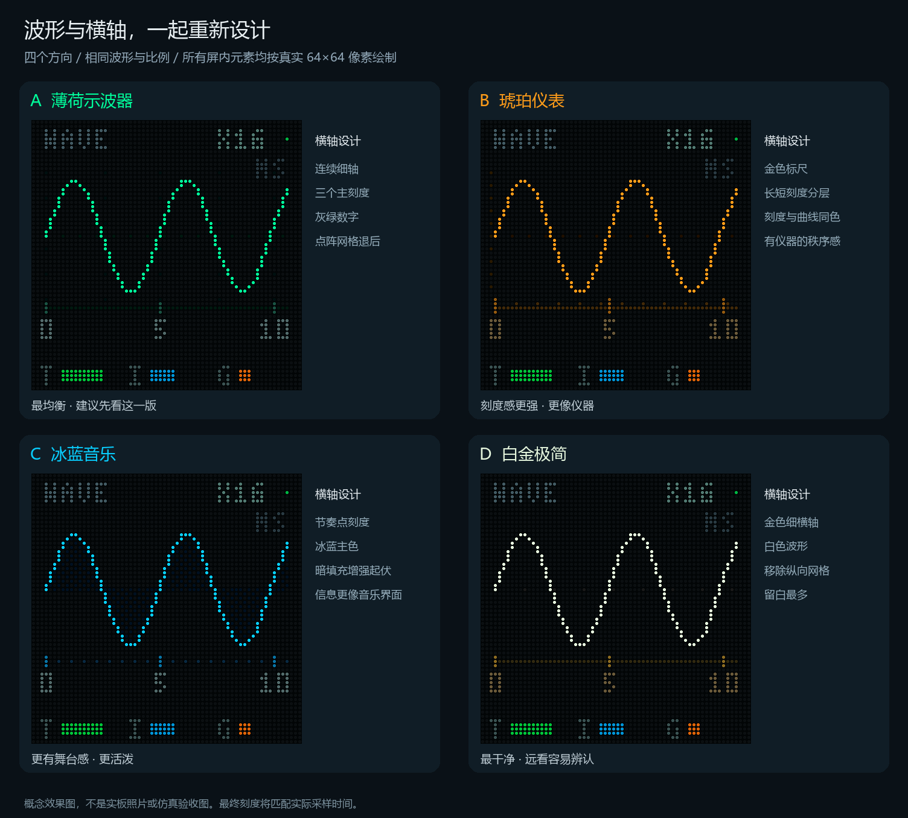
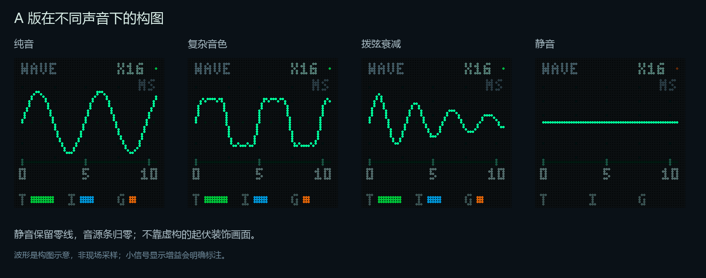

# LED 波形与横轴外观候选

2026-10-22，依据 Photograph 中的七张实拍照片制作。先看图选方向，再落实 FPGA 显示布局。

| 方案 | 视觉重点 | 横轴设计 |
| --- | --- | --- |
| A 薄荷示波器 | 主波形突出，背景克制，推荐作为起点 | 低亮细线、三个主刻度、稀疏网格 |
| B 琥珀仪表 | 暖色，明确的仪器秩序 | 金色标尺，长短刻度分层 |
| C 冰蓝音乐 | 起伏更显眼，适合音乐展示 | 点状时间轴、暗色填充 |
| D 白金极简 | 白色波形，留白最多，远看清楚 | 金色细轴，移除纵向网格 |

四版使用相同的示意波形、坐标比例和音源条，方便只比较视觉。屏内所有文字、波形、刻度都按真实 64×64 整数像素绘制；各颜色限制为 RGB5。放大图没有增加像素、模糊或光晕。

时间轴采用 0、5、10 三个主要数字，MS 标识单位；最终位置需要与选定采样窗口匹配。X16 是显示增益示意。T / I / G 分别表示触摸、红外/手势、吉他，底部幅度条保留三种音源色。

这些是设计效果图，不是实板照片、现场采样或仿真验收结果。当前生产 RTL、测试和标准位流没有因选图而替换。

每版有 `*_concept.png` 独立效果图、`*_pixels_64.png` 原始像素图和 `*_pixels_enlarged.png` 最近邻放大图。

复现：在 pcm5102_pam8403 目录运行 `python tools/render_scope_concepts.py`，需要 Pillow 和 Windows 微软雅黑字体。

后续按用户建议增加 [FSR 联动量程方案](FSR_RANGE.md)：FSR 音量比例、显示倍率、真实峰值电平分别标注，附 100% / 50% / 25% 三档效果图。仍为设计稿。

实施后的实际 RTL 像素输出见 [仿真画面](verified/scope_verified_comparison.png)，实现规则见 [新版波形说明](../../SCOPE_DISPLAY.md)。前面的概念稿保留用于设计对照，最终布局和资源以新版说明及交付包为准。
