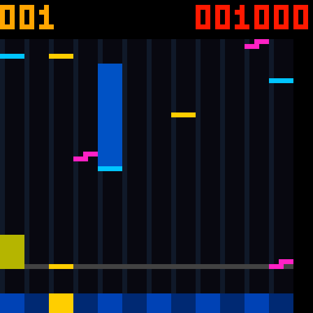

# Code44：粉色 FLICK 阶梯轮廓

2026-10-28。修正Code43只给FLICK换成粉色、仍画成横条的问题。按照用户参考图中的六个粉色像素，改为整体5×2像素的阶梯：

```text
..###
###..
```

上排右侧3点，下排左侧3点；下排保持原来的到线判定位置。TAP保持5×1像素，HOLD尾条、黄色DRAG和下方十二键各5像素宽。顶部红色得分、命中变黄和四类判定继续保留。

- [Code44 APK](../../android_app/dist/FPGA-Music-Rhythm-Flick-Code44.apk)，App 1.43-rhythm-flick，更新音符形状说明。
- [Code44 配套位流](PCM5102_UNIFIED_RHYTHM_FLICK_CODE44.fs)
- [用法](../../RHYTHM_GAME.md)、[产物指纹与资源](release.json)

APK SHA256：`319C838FFC708DDEF4725364E6D48E6134FAED09930D7BC5EABE456BF92302EB`。

位流 SHA256：`2447F02E1067BB8B36AF6E406DC38CD685B7EB9A127D796FEC442A9AB2285157`。

## 实现与资源

仅修改FPGA的 `hub75e_rhythm_display.v`。复用已有两份面板缓存，在每行消隐时先读取相邻行的FLICK上排、再读取本行音符；两次读取冻结同一个滚动原点。不新增BSRAM、每个音符的计时器或曲谱事件写入次数。头部、上排一同滚动，包含跨31/32行的显示。其它FPGA输入逐项与Code43冻结版本一致。

最终候选 `rhythm_flick44_b`，Gowin V1.9.11.03 Education，GW5A-LV25MG121NC1/I0，place2/route0/maxfan23，保留原生32/36位BSRAM。

Logic 22848 / CLS 11497 / Register 11624 / BSRAM 54 / DSP 25，剩23 CLS。50MHz完整布通，主时钟与ADC时钟setup/hold违例均0，最差余量 +0.053/+0.153 ns。 BSRAM使用54/56，余2块。CLS余量比此前35个预留口径少12个，后续扩展需重新评估资源和时序。

## 验证与边界

- [外部RGB显示回归](display_tests.log)：逐像素/PWM检查FLICK的5×2轮廓及空白角、31/32行跨区、判定线54、滚动和STOP清屏；TAP/长按/DRAG、十二个底键、得分和133时钟扫描通过。
- 同轮检查600/2300/60000ms长按尾条、独立64行模型与994个密集音符、旧七列6174组参考扫描行，均通过。测试源与日志指纹见release.json。
- [导出像素核对](exported_pixels.log)、[FPGA输入比较](input_comparison.log)、[实际RTL分数快照解析](app_snapshot.log)通过。
- [APK构建](apk_build.log)完成Java/D8/aapt2编译、版本及签名核对。
- [路由后网表扫描](routed_scan.log)：40组64列外部RGB行、133时钟、已知像素和消隐/LAT顺序通过。这是启动扫描检查，不是整局门级玩法测试。

默认APK、默认位流及综合/路由输出已与同一最终候选同步。没有安装手机、烧录FPGA或做实体面板验收。玩法/音频等未改部分的更早验证见[Code43](../rhythm_width5_20261028/README.md)及[Code42](../rhythm_notes_20261028/README.md)。

## 未交付候选

候选a的像素测试通过，但布局布线报539条未布通，未生成可交付位流。随后改为消隐期复用原缓存，b使用place2完成验证。备用c从同一RTL尝试place4，在b完整布通且时序通过后停止，不计为验证通过。a的源码和构建日志保留用于追溯。

## 回退与复现

[rollback_Code43](rollback_Code43/) 保存改动前的源码、App、测试、文档和默认APK/位流；Code43命名产物仍保留。未进行Git提交。

```powershell
& ./tools/run_sim.ps1 -Quick -Tests @('tb_rhythm_panel','tb_rhythm_tails','tb_rhythm_raster','tb_hub75e_rhythm_display')
& ./android_app/build-apk.ps1 -OutputApk dist/FPGA-Music-Rhythm-Flick-Code44.apk
& ./tools/check_unified_build.ps1 -Label <新标签> -SynthesisOnly
& ./tools/resume_unified_pnr.ps1 -Label <新标签>
```


