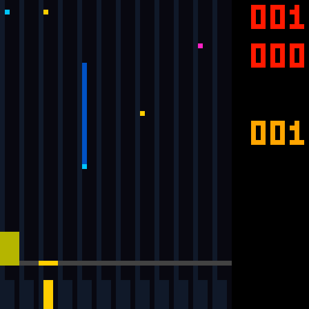

# 四类音符、完整长按尾条与曲谱页音游：Code42

2026-10-28。App **1.41-rhythm-notes / Code42**，FPGA 最终候选 **rhythm_notes42_capture**。默认 APK、默认工程综合/路由输出已同步。本轮没有安装手机、烧录 FPGA 或写板上 Flash。

## 交付

- [Code42 APK](../../android_app/dist/FPGA-Music-Rhythm-Notes-Code42.apk)，与默认 `FPGA-Music-Unified.apk` 字节一致。
- [Code42 位流](PCM5102_UNIFIED_RHYTHM_NOTES_CODE42.fs)，与默认 `impl/pnr/PCM5102_UNIFIED.fs` 字节一致。
- [操作与 CSV 格式](../../RHYTHM_GAME.md)、[四类音符练习谱](../../android_app/examples/rhythm_four_types.csv)。App 曲谱页也有“载入四类音符练习谱”按钮。
- [发布审计与哈希](release.json)、[冻结 FPGA 输入](frozen_inputs.json)、[实际资源报告](PCM5102_UNIFIED.rpt.txt)；Gowin 生成的 `PCM5102_UNIFIED.tr.html` 计时报告包属可重建产物，按 `.gitignore` 留在本机。

APK SHA256：`CBDEB87D7F54F9BD190940C3DE90DA27E1F0850F780D280A7C34666C2F131FDB`。

位流 SHA256：`96F110658DA0F2206D5450C1D0DD7DD3EB662279909C9BDA0E75B4D0D6D9E816`。

## 已实现

1. “十二键音游”从设备页移到曲谱页。音游提示界面底部只显示 K1～K12，移除 K13～K16 的四个提示格；四个实体键的音频演奏功能保留。
2. TAP 蓝色点击、HOLD 蓝色长条持续按住、DRAG 黄色接住（允许预先按住和连续接住）、FLICK 粉色跨键滑动或 APDS-9960 任意已识别方向手势。
3. HOLD 按事件持续时间产生尾条，随头部下落；被接住后变黄，在判定线处逐段消失，消失即可松手。中途松开、STOP 打断仍失败。
4. 得分移到右侧，红色六位分上下各三位；其下黄色连击。普通成功和 HOLD 保持均用黄色，Miss 红色。右侧六位是同一个得分，例如 `001` / `000` 为1000分。
5. CSV 新增可选 `note_type`，支持明确指定时长超过500ms的 TAP、短于500ms的 HOLD，以及 DRAG、FLICK；导出保留类型和弯音。旧曲谱、旧命令和弯音能力查询保持兼容。

FLICK 复用串行接触扫描器记住判定窗内的目标接触，再等待跨键动作或手势，允许目标键在滑动时松开；单纯按住不能得分，从未接触目标的手势和上一条音符的手势不能刷分。TTP229 无连续坐标，单个焊盘内部移动不能识别方向；APDS-9960 初始化、真实手势延迟和实物灵敏度仍待上板验证。

**音符尺寸假设：** 当前头部1像素高，宽度1或2像素。用户文字“像素5”是否要求宽5像素已单独询问，尚未收到答复，本轮没有把它认定为已实现5像素宽。

## 最终资源与时序

Gowin V1.9.11.03 Education，GW5A-LV25MG121NC1/I0，50 MHz，place2 / route0 / maxfan23；原引脚与时钟约束保留，原生32/36位 BSRAM。

| 资源 | Code41 | Code42 | 剩余 |
|---|---:|---:|---:|
| Logic / 23040 | 22542 | 22758 | 282 |
| CLS / 11520 | 11426 | 11487 | **33** |
| Register / 23280 | 11525 | 11581 | 11699 |
| BSRAM / 56 | 54 | 54 | 2 |
| DSP / 28 | 25 | 25 | 3 |

完整布通、未布通0；clk 和 ADC 时钟 setup / hold 违例端点全部0。最差原始 setup / hold slack **+0.560 / +0.146 ns**。上述资源来自同一最终路由结果，不以综合 LUT 数推算 CLS。

相对 Code41 增加216 Logic、61 CLS、56 Register，BSRAM/DSP没有增加。**实际余量33 CLS，比旧文档的35 CLS预留少2；本轮没有声称仍满足35 CLS预留。** 所有原音源、三效果器和 TAKE 保留。

尾条由曲谱已有未来时间游标持续写入显示滚动缓存。三个位平面区分四类音符头和 HOLD 身体，仍使用原生36位块，避免每条长按的计时器和逐音符位置寄存器。长于屏幕的尾条从顶部持续进入，最长60000 ms不回绕成短尾。同列同像素的极密音符会合并显示，实际判定仍逐事件完成。

构建脚本现已显式 `set_option -convert_sdp32_36_to_sdp16_18 0`，冷构建不再依赖被忽略的本机 process_config。否则54块原生 RAM 被拆分后会变成70块并超出器件。

## 验证

本轮17组针对性 RTL 检查通过，App 全部核心回归、编译、签名和 Code42 版本核对通过。主要证据：

- [最新判定与尾条](capture_judgement.log)：显式长 TAP、短 HOLD、完成/断按、连续预按 DRAG 和和弦、FLICK 手势/滑动/松开目标/无目标手势拒绝；旧四档正负窗口和128条满分192000回归。600/2300/60000ms尾条长度、裁切、缩短、消失、STOP清图。
- [四类型整机](types_top.log)：真实 UART 下载六事件，真实 TTP229 串行模型完成 TAP、HOLD、提前按住的 DRAG、离开目标的 FLICK，**4500分 / 4连击**；AUDITION不计分，外部I2S、音频期限和溢出检查通过。
- [外部面板与旧扫描](color_final.log)：实际 RGB5/PWM，蓝 TAP/HOLD 身体、黄 DRAG/命中、粉 FLICK、右侧红色得分和十二键底栏，133时钟行扫描。旧七列扫描也按新的黄色命中反馈核对。
- [协议与旧命令](regression.log)：四类型 mask 和弯音通过 UART 到达曲谱 RAM；能力查询、非法类型/显式休止拒绝；512条旧命令差分逐回复与控制值通过。该日志后段一次旧测试层级引用编译失败，已修复并由 color_final.log 的6174组行参考检查覆盖，未把失败记为通过。
- [其他回归](regression_remaining.log)：显示页/遥测、43/33字段 TAKE、完整528位三效果原子快照。旧扫描白色期望后续按需求更新为黄色，最终以 color_final.log 为准。
- [逐周期对照](live_equivalence.log)：1124条键态消息和背压；150000拍传感器暂存、1778快照、1710转发、1029满队列周期，音频/队列/溢出一致。
- 原 `tb_rhythm_raster` 的6500ms回绕、994个密集头、8次反压、STOP初始化通过；`tb_control12_dense` 的128×1ms、十二路、休止和逐事件弯音通过；原 `tb_rhythm_top` 的2500分点按+休止+长按通过。
- [App 核心](app_core.log)：类型CSV、弯音2401值、导出往返、旧曲谱、REST拒绝、蓝牙、录制/场景及计分解析；[APK构建](apk_build.log) 包括 Java/D8/aapt2 和签名/版本检查。
- [最终路由网表扫描](routed_scan.log)：40组外部64列RGB行，133时钟周期、已知像素、消隐/LAT顺序。**这是启动与扫描检查，完整四类玩法在 RTL 整机验证，不宣称完成整局门级仿真。**

最终冻结 FPGA 的源码、ROM、约束、工程与工作树逐文件哈希匹配；发布审计记录 APK、位流和当前 App 输入指纹。没有真实手机蓝牙、实体触摸/手势、LED观感和DAC听音验收。

## 复现与回退

在 `pcm5102_pam8403` 中：

```powershell
& ./tools/test_rhythm.ps1 -RoutedScan
& ./android_app/build-apk.ps1 -OutputApk dist/FPGA-Music-Rhythm-Notes-Code42.apk
& ./tools/check_unified_build.ps1 -Label <新标签> -SynthesisOnly
& ./tools/resume_unified_pnr.ps1 -Label <新标签>
```

[rollback_Code41](rollback_Code41/) 保存本轮起点的核心修改源码、App入口、默认APK/位流；[Code41完整交付](../rhythm_game_20261027/README.md)及命名APK/位流仍保留，可配套回退。本轮没有Git提交。

中间候选未发布：默认拆分配置的a需70块RAM；c完整布通且时序通过但剩25 CLS；独立动作判定的release/final/f49/slim候选综合超Logic上限。最终用接触扫描器保留目标接触，形成上述33 CLS余量，未叠加失败候选的收益。


