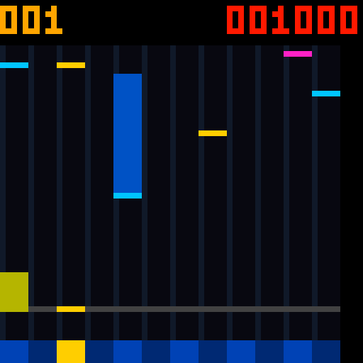

# Code43：TAP 与下方按键固定五像素宽

2026-10-28。用户已明确 TAP 就是五像素宽，下方按键同样处理。本轮将音游提示改为十二列、每列固定5像素，App **1.42-rhythm-5px / Code43** 移除1/2像素宽选项。

## 交付与布局

- [Code43 APK](../../android_app/dist/FPGA-Music-Rhythm-5px-Code43.apk)
- [配套位流](PCM5102_UNIFIED_RHYTHM_5PX_CODE43.fs)
- [音游操作说明](../../RHYTHM_GAME.md)、[最终产物指纹](release.json)

**TAP 为5像素宽、1像素高；下方十二个键各宽5像素。** HOLD 的头部/尾条、DRAG、FLICK 也统一宽5像素。K1占 x=0～4，K2占5～9，依次到K12占55～59；60～63不显示额外触摸键。底部用深浅蓝交替区分相邻键，命中亮黄。

得分改为右上方横排红色六位数字，左上方黄色三位为连击。顶部8行留给分数；完整长按尾条、四类判定、手势和跨键滑动继续保留。

扫描时用五列计数器推进键号，保持每行133时钟，不在像素路径引入除5器。滚动缓存、曲谱时基和判定线位置不变。

APK SHA256：`0A62F2B96FF5B10E698EA0A0F9A609FE1BA33BF4DC77DEA73BACE314EC85B421`。

位流 SHA256：`488583796F1003F7DB4D492F2A043DA10087114E093C8B1F552DC952DF864E3E`。

默认 APK / FPGA 入口及综合/路由报告已同步，产物字节哈希一致。

## 同一最终候选的实际资源

最终标签 `rhythm_width5_43a`，Gowin V1.9.11.03 Education，GW5A-LV25MG121NC1/I0，50MHz，place2 / route0 / maxfan23，原生32/36位BSRAM。

| 资源 | Code42 | Code43 | 剩余 |
|---|---:|---:|---:|
| Logic / 23040 | 22758 | 22785 | 255 |
| CLS / 11520 | 11487 | 11485 | **35** |
| Register / 23280 | 11581 | 11590 | 11690 |
| BSRAM / 56 | 54 | 54 | 2 |
| DSP / 28 | 25 | 25 | 3 |

完整布通、未布通0；主时钟与ADC时钟 setup / hold 违例端点全部0，最差原始余量 **+0.275 / +0.163 ns**。剩余35 CLS，达到此前35 CLS预留口径；不以Logic增减估算CLS。

## 本轮验证

- [显示与尾条回归](display_tests.log)：外部RGB5/PWM逐像素验证5列TAP/HOLD/DRAG/FLICK，包括最后的K12；十二键各5像素全覆盖；横排红色得分、黄色连击、133时钟扫描；600/2300/60000ms尾条、滚动/清图、旧七列6174组参考行通过。
- [宽度兼容专项](width_bit_compat.log)：采集一整轮32级PWM时切换旧宽度位0/1，两种值均保持5像素；核对相邻列和音符上下边缘，避免宽度只在一部分列或灰度级正确。
- [App遥测](app_snapshot.log)：96组设置组合及当前RTL实际分数快照解析通过。专项夹具恢复宽度位后已增加两个时钟等待遥测稳定，避免导出旧设置值；不改计分器或伪造数据。
- [APK构建](apk_build.log)：Java/D8/aapt2、签名和 Code43 / 1.42-rhythm-5px 版本核对通过。
- [路由后扫描](routed_scan.log)：40组64列外部RGB行、133时钟周期、消隐/LAT顺序和像素已知性通过；此为启动扫描检查，不声称重新完成整局门级玩法验证。

与Code42冻结输入比较，本轮FPGA只改 `hub75e_rhythm_display.v`；音频、判定、曲谱、传感器、TAKE、约束和引脚均相同。四类玩法的4500分整机验证和其他17组回归保留在[Code42记录](../rhythm_notes_20261028/README.md)，不声称本轮重新跑完全部测试。没有安装App、烧录FPGA或做实物面板验收。

## 复现与回退

```powershell
& ./tools/test_rhythm.ps1 -RoutedScan
& ./android_app/build-apk.ps1 -OutputApk dist/FPGA-Music-Rhythm-5px-Code43.apk
& ./tools/check_unified_build.ps1 -Label <新标签> -SynthesisOnly
& ./tools/resume_unified_pnr.ps1 -Label <新标签>
```

[rollback_Code42](rollback_Code42/) 保存本轮改动前的显示源码、App源码/版本、测试、说明及默认APK/位流。Code42的命名APK、位流和冻结源码仍保留；回退需成套恢复。本轮未Git提交。


