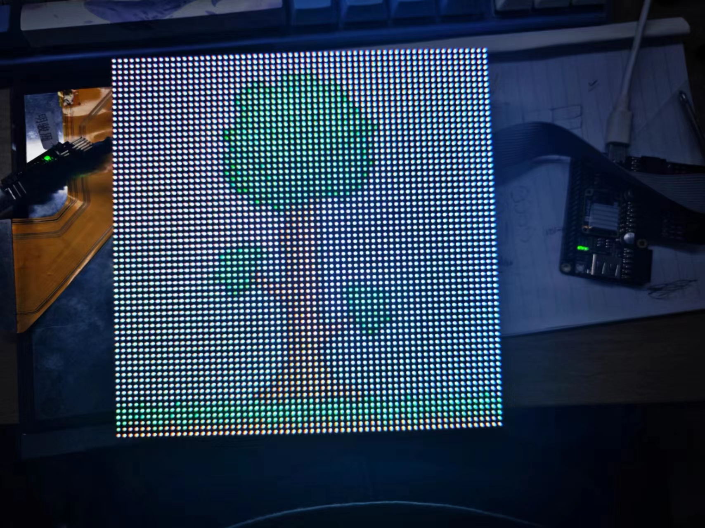
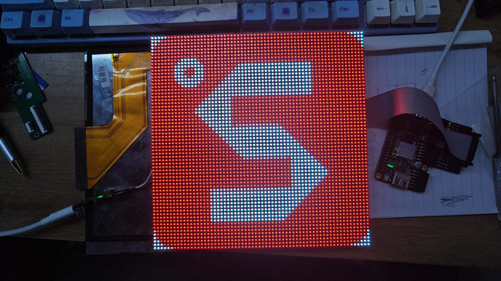

# Tang Primer 25K：HUB75E + TTP229 交互点阵屏

## 2026-10-07：S2 选择 8 键 GPIO / 16 键串口，两种模式都带显示

当前工程上电默认 **8 键**。板载 S2 / H10 每次按下稳定 20 ms 切换一次，
松开保持：`mode_16=0` 直接读取 OUT1～OUT8、SCL 保持空闲；
`mode_16=1` 用 SCL/SDO 读取 16 键；长按不重复。两种输入都控制同一块 HUB75E 点阵屏。
使用两级同步、`case` 防抖状态机和串口重对齐状态；中途切换丢弃旧帧，
清除 UI 防抖但保留图案和亮度。K1/K2 切图；8 键时 K7/K8 调亮度，
16 键时仍是 K15/K16。

新增 `src/ttp229_gpio_input.v`：保留八键两级同步、每键独立 20 ms 防抖和 600 ms 启动等待，
再由 UI 确认 3 个 1ms 采样。OUT1～OUT8 沿用 GPIO 工程的
K1/L2/J4/G1/G2/L3/L4/J2，已经加入主 `.cst`；串口仍使用 F6/F7。
输入来源由 S2 选择，接线由用户手动改变，模块 TP2 配置对应 8/16 键。
`ttp229_gpio` 是无点阵显示的独立 GAO 工程；带显示的两种输入都在本工程中使用。
详细模式行为与两个工程的接线差异见 [S2 使用说明](../MODE_SELECTION.md)。
本次生成的位流、配套 GAO 和时序检查见 [验证记录](VERIFICATION.md)。
GAO 当前采集 82 位、深度 8192，包含模式、S2、读位状态及计数、八根 OUT、
直读原始/防抖键值、启动完成和直读 valid。
本轮未下载硬件；以下旧位流校验值和实板采集描述属于历史记录。

## 2026-10-06 的实现与实板记录

以官方 64×64 `pmod_hub75e` 例程为基础，加入 TTP229-BSF / HW-136 的
16 键串行输入，实现图案选择和亮度调节。启动显示 `logoT`，亮度为第 8 档。

当前主调试位流为 `impl/pnr/ao_0.fs`，校验值 **0x2187**，配套 `src/HUB75E.gao`
的 GAOCRC 为 **1010001010110110**。已实际下载并完成强制采集；当前实测键值仍为
`0000`、SDO 为高，**尚未验证触摸键 1 成功**。

## 接线及模块配置

- HUB75E 接 USB-C 附近的两个 PMOD，保留官方全部 HUB75E 管脚分配。
- 50 MHz 晶振接 E2；S1 / `USER_KEY` 接 H11，**按下为高**，松开由内部下拉保持低。
  按照 [Dock 60033 官方原理图第 1 页](https://dl.sipeed.com/fileList/TANG/Primer_25K/02_Schematic/Tang_Primer_25K_Dock_60033_Schematic.pdf)
  设置 `PULL_MODE=DOWN`、`uresetn <= ~USER_KEY`。此前错误极性会在松开 S1 时保持业务复位，
  并使原先随复位停止的 GAO 时钟无法采集；现已修正，GAO 时钟在复位期间也继续运行。
- `touch_scl` 输出接 F6（40Pin 排针 SDRAM A0）；`touch_sdo` 输入接 F7（SDRAM A1），FPGA 输入开启上拉。两脚所在 bank 为 3.3 V，模块与 FPGA 共地。
- **短接 TP2** 才启用本工程使用的 16 键串口模式；多键组合操作需要 **TP3、TP4 都短接**。修改跳线后必须断电重新上电。
- 默认 SDO 低有效，`TP_ACTIVE_LOW=1`；控制器转换后 `touch_keys[i]=1` 表示物理按键 `i+1` 按下。
- 模块直接连接 FPGA 3.3V IO 时，VCC 使用 **3.3V** 并共地。5V 供电的 TTP229 要求更高的 SCL 保证高电平，SDO 也不能当成 3.3V 输出。

## 操作

| 模块按键 | 功能 |
| --- | --- |
| 1 | 显示 `logoS.hex` |
| 2 | 显示 `logoT.hex` |
| 15 | 亮度减 1 档 |
| 16 | 亮度加 1 档 |
| S1 | 复位，恢复 logoT、亮度 8 |

亮度范围为 1～8，达到边界后保持。两个切图键在同一次确认中按下时，键 2 优先；
两个亮度键在同一次确认中按下时抵消。长按只动作一次，稳定松开后才能再次触发。
这些优先规则作用于新的按下事件，已长按的键不会持续覆盖后来的按下事件。

## 数据路径及扫描

`CLK_IN`（50 MHz）驱动 `ttp229_ctrl` 和 `touch_ui`。SCL 半周期为 50 μs，
16 位读取耗时约 1.6 ms；每帧结束的 `touch_valid` 持续 20 μs，之后 SCL 高电平静置
3 ms，使芯片串口通过无边沿超时重新对齐。首次/复位后读取先等待 **600 ms**，覆盖芯片约
0.5 s 的启动稳定期；连续帧间隔约
4.57 ms。`touch_ui` 只在
valid 上升沿采样一次，完整 16 位键值连续 3 帧相同才提交；按下和松开都防抖。
局部读帧结果不会直接驱动交互动作。

`TP_ACTIVE_LOW` 同时控制 SCL 和 SDO：低有效时 SCL 空闲高、下降沿开始读位；高有效时空闲低、
上升沿开始读位，两种模式都在有效电平末采样。此前高有效参数只反转数据的缺陷已修正，
仿真模型也改为按真实极性的边沿推进位序。

显示使用独立 `scan_div` 生成的 25 MHz 扫描时钟、每行 67 个周期和 32 级 PWM。
`scan_div` 在业务复位时清零，保留扫描与同步 ROM 的初始化相位；GAO 使用的 `clkn` 独立自由运行。
`hub75e_if` 先预读同步 ROM，再发送 64 列，消隐后发送一次 LAT，保持行地址
直至下一次锁存。补齐了例程中同步 ROM 导致的首列重复、末列漏发和额外 CK/LAT，
并支持扫描时钟停止时的复位；首次完整行锁存前屏幕保持消隐。

`frame_clk` 是**每行**锁存标记。主时钟计数 32 行 × 32 PWM 相位后，才把请求的
图案和亮度提交到 `image_active`、`brightness_active`，避免一轮 PWM 内混用配置。
亮度映射为 `floor(5位颜色值 × 档位 / 8)`，再与 PWM 相位比较；第 8 档保留原颜色值。

两张图各为 2048×32 位（每字包含上下半屏两个像素），共使用 8 个 BSRAM。
保留官方 `src/gowin_prom/gowin_prom.v` 的 T 图 IP；新增 S 图采用相同原语和单拍读时序，
初始化数据直接写入 Verilog，综合不依赖 hex 相对路径或 `#` 格式头。

调试输出：`dbg0=touch_keys[0]`、`dbg1=touch_keys[1]`、`dbg2=touch_valid`。
当前已配好 `src/HUB75E.gao`：用 `clock=clkn[3]`（3.125 MHz）采样，深度 16384，
触发位置 12288，按下/松开的稳定键变化触发。GAO 显示原始键值、稳定键值、图案/亮度的
请求值及实际扫描值，并直接包含 `touch_scl`、`touch_sdo` 和 `USER_KEY`；
`gao_touch_debug` 将短事件变成 20 μs 脉冲，并在主时钟下降沿统一快照。
显示时钟改名为 `scan_clock`，仍为 25 MHz。没有 LED 屏也能观察触摸与交互状态。
操作步骤和预期波形见 [GAO触摸调试](docs/GAO触摸调试.md)。
`debug/polarity_compare/` 中的 LOW/HIGH 和 FRAME、LIVE 等旧位流保留为历史采集快照，未包含最终主工程的
完整复位/时钟修复，当前调试使用上述主位流与配置。判定触摸成功必须观察松开、按键 1、
松开对应 `0000 → 0001 → 0000`；回环出现 `FFFF` 只验证 FPGA 收发路径。

2026-10-06 本轮补充：高有效工程已重新构建，`debug/touch_high/impl/pnr/ao_0.fs`
（校验值 **0xE16C**）含当前复位/`scan_div` 修复，配套 `Touch_HIGH.gao`
的 GAOCRC 为 **1010001010111000**。20:05:35 下载 Finished（5.4 秒），
但强制采集未完成，没有有效 HIGH 波形，不能据此判断模块极性。
20:10:56 已重新下载主位流 **0x2187**，Finished（5.41 秒），只保留一个主 GAO 实例；
主工程上一轮完整采集仍为 SDO 高、原始键值 `0000`，触摸键 1 尚未成功。
旧 `polarity_compare/HIGH_600ms.fs` / `HIGH.gao` 快照未更新。

## 工程与验证

打开 `HUB75E.gprj` 即包含全部综合源、F6/F7 约束、GAO 配置，以及 50 MHz 主时钟、25 MHz
显示时钟和 3.125 MHz GAO 采样时钟约束。仿真文件未加入综合工程。烧录后按一次 S1 可重新初始化。

在工程目录执行：

```powershell
# 需要 Icarus Verilog、Python 3 和 Gowin 的 gw5a 仿真原语库
.\tools\run_sim.ps1

# 工具不在默认路径时，可显式指定
.\tools\run_sim.ps1 -IverilogDir 'C:\iverilog\bin' `
    -GowinSimlib '<Gowin安装目录>\IDE\simlib\gw5a\prim_sim.v'

# Gowin 综合、插入 GAO、布局布线并生成调试位流 impl/pnr/ao_0.fs
gw_sh tools/build.tcl
```

仿真脚本也支持 `-Tests tb_touch_ui` 等子集，产物放在 `sim/build/`。
测试覆盖 8/16 键、两种有效极性、键位顺序、串口周期和复位；valid 单次采样、
完整帧防抖、长按和亮度边界；两张图全部 4096 个 ROM 字；64 列顺序、32 行扫描、
LAT/消隐；以及串行触摸到实际 RGB 输出的完整联动和 S1 重启。

本机使用 Gowin **V1.9.11.03 Education** 和其官方 GW5A 仿真库验证。
提示词中提到的 V1.9.9 需要在该版本中重新综合、布局布线确认。仿真及生成位流不等同于上板实测。

当前 **7 项自检全部通过**，包含 8/16 键的真实双线极性模型、完整 600 ms 冷启动，以及顶层联动。
完整顶层自检核对了 1,572,928 个 RGB 像素和 24,577 次行锁存；该项将触摸启动等待缩短为 3 ms，
默认 600 ms 启动等待由独立 `tb_ttp229_startup` 在 1 MHz 主时钟下验证。
触摸模型在读满后保持末位，仅在 SCL 无边沿超过 2 ms 后重新对齐，且不随 FPGA 复位直接清零芯片读位计数。
其中 GAO 调试自检验证快照位域、采样前稳定时间和 20 μs 触发事件。
顶层自检使用真实 S1 极性，验证按下复位、松开恢复，以及复位期间 GAO 时钟持续运行。
GAO 已成功插入、布局布线并生成 `impl/pnr/ao_0.fs`，采集 47 位信号，分析仪使用 48 个 BSRAM，
加上 ROM 的 8 个，合计 **56/56**。**时序尚未全部收敛**：最新
`impl/pnr/HUB75E_tr_content.html` 报告 setup 违规 0、hold 违规 2。
反馈路径涉及分频输出作为生成时钟根的时序建模，尚未证明可以忽略；
保留真实时钟约束，没有用 false path 或人为延迟消除报告条目。
当前主位流已实际下载（Finished，5.46 秒），F3 强制触发可出波形；
触摸键 1 的实板响应和完整时序验收仍未通过。

## 本次文件改动

- 修改：`src/top.v.v`、`src/HUB75E.cst`、`src/ttp229_ctrl.v`、`sim/tb_ttp229.v`、`HUB75E.gprj`、本说明。
- 新增 RTL / 约束：`src/touch_ui.v`、`src/display_rom.v`、`src/HUB75E.sdc`。
- 新增自检：`sim/tb_touch_ui.v`、`sim/tb_display_rom.v`、`sim/tb_hub75e_scan.v`、`sim/tb_top.v`、`sim/tb_ttp229_startup.v`。
- 新增工具：`tools/run_sim.ps1`、`tools/build.tcl`、`tools/generate_display_rom.py`，以及忽略仿真产物的 `.gitignore`。
- GAO 补充：修改 `src/HUB75E.gao` 并加入工程；新增 `src/gao_touch_debug.v`、`sim/tb_gao_touch_debug.v` 和 `docs/GAO触摸调试.md`。

## 更新图案

修改 `logoS.hex` 后运行 `python tools/generate_display_rom.py`，再重新构建。
`python tools/generate_display_rom.py --check` 可核对 ROM 与两份源图数据一致。
修改 `logoT.hex` 时，先用 Gowin IP 工具重新生成官方 `Gowin_pROM`，再运行生成脚本；
脚本会拒绝复用与新 T 图不一致的旧 IP。扩展第三张图时，需要增加 ROM、选择宽度及键位映射。

以下保留官方接线图片及图案转换示例：




hex file generate by python code:   
```   
from PIL import Image
import numpy as np
im = Image.open("S.bmp")
img = np.array(im)
shape=img.shape
print("#File_format=Hex")
print("#Address_depth=%d"%(shape[0]*shape[1]/2))
print("#Data_width=32")
for y in range(32):
    for x in range(shape[1]):
        rgb1 = (img[y,x,2]>>3)|((img[y,x,1]>>3)<<5)|((img[y,x,0]>>3)<<10)
        rgb2 = (img[y+32,x,2]>>3)|((img[y+32,x,1]>>3)<<5)|((img[y+32,x,0]>>3)<<10)
        print("%04X%04X"%(rgb1, rgb2))
```


